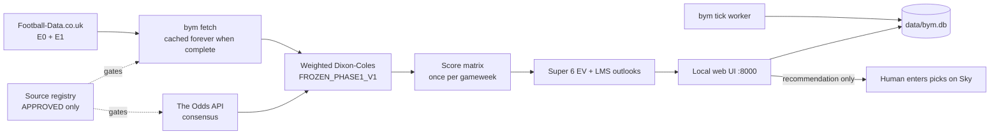
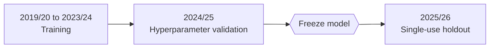

[View Repo :octicons-mark-github-16:](https://github.com/Ready2k/bym){ .md-button }

# Beat Your Mates — Always-On Prediction Agent

**TL;DR:** A spec-driven prediction agent for Sky Super 6 and Last Man Standing. A frozen, weighted Dixon-Coles model turns historical results into score matrices and expected-value picks, blended with bookmaker odds. The agent recommends and the human enters the picks, because it has no way to submit anything to Sky.

**Stack:** Python 3.12 • uv • numpy/scipy/pandas • PuLP • SQLite • stdlib `http.server` + vanilla JS UI • Docker Compose • macOS LaunchAgent

---

## ✨ Features

- **⚽ Quantitative core** - Historical results feed a weighted Dixon-Coles model, then a score matrix, then Super 6 expected value, giving six recommendations plus a Golden Goal pick
- **🧪 Walk-forward backtesting** - Every model change is compared against baselines on held-out seasons, with ablation scripts for Elo, market, shot-proxy and totals variants
- **🎯 Last Man Standing mode** - Picks stay provisional until kickoff, and the dashboard previews every eligible club for each entrant
- **📈 Market and availability layers** - The Odds API consensus (20 UK books), football-data.org results and Tavily news run as separately scheduled jobs
- **🕒 Restart-safe scheduler** - SQLite-backed jobs of three types (`POLL_ODDS`, `POLL_AVAILABILITY`, `KNOWLEDGE_RESEARCH`) polled by `bym tick`
- **🖥️ Local decision UI** - Home, Round, Cup Match, League, Opponents, Performance, Activity and an Expert group (Model Lab, Sources, System Health, Settings)
- **🏆 Season simulation** - Monte Carlo season simulator labels rounds ATTACK, DEFEND or NORMAL against private-league opponents
- **🔁 Self-healing service** - A macOS LaunchAgent runs at login and re-runs `start` every 300 seconds
- **🔭 Fantasy Premier League** - A 29-module `fpl/` package covers harvest, projection, lineup and transfer optimisation, with its own 1,636-line spec

---

## 🧠 Architecture

Seasons are assigned fixed roles by `docs/VALIDATION.md`:

---

## 🎯 What Makes This Special

### Rules enforced by tests, not by convention
Each rule has a test or gate behind it, because breaking it silently invalidates a result. `FROZEN_PHASE1_V1` writes every parameter out literally (`xi=0.003`, `market_blend_weight=0.5`, `refit_every_days=7`), so any change shows up as a diff in review. A failing test means the freeze was violated. The prospective 2026/27 comparison depends on this: if the constant drifted, the new agent would be compared against itself.

### A holdout that can only be spent once
`assert_holdout_unspent` raises `HoldoutAlreadySpentError` whenever `results/final_test_<season>.md` already exists. No flag or caller can override it. It was added after a logged protocol breach on 2026-08-08, when a holdout was re-run and compared again. The existing result file is the record, and a new holdout needs a new season.

### Source gating and the Sky boundary
The registry in `sources/registry.py` refuses queries to any source that isn't `APPROVED`. Promotion from `REVIEW_REQUIRED` is a deliberate human act, and `PROHIBITED` sources cannot be promoted. Sky Sports Super 6 is marked permanently prohibited, so fixtures and deadlines are entered by hand and no submission path exists. The agent sits outside Sky by design: it recommends, and the human submits.

### Compute once, reuse everywhere
The `FixtureOutlook` dataclass holds one fixture's 1X2 probabilities. Ranking is per entrant, but the score matrix is not, so it is computed once per fixture and shared. The dashboard and the horizon planner both rank the same gameweek repeatedly, and this stops them refitting per entrant.

---

## 🚀 Technical Highlights

### Modelling
- Dixon-Coles with time decay, a tail-tolerance goal grid (`min_goals_grid=10`, cap 20), `rho` bounded to ±0.2 and λ clamped to 0.05-6.0
- Elo, market, Golden Goal and shot-proxy modules sit beside the core. The shot proxy was built, ablated (`ablation_009`) and rejected
- `engine_status.md` uses strict status levels (BUILT, TESTED OFFLINE, LIVE VERIFIED, ACTIVE, SHADOW), so an adapter that exists is never described as live

### Service layer
- `bym serve` uses stdlib `http.server`, with `api/contracts.py` as the frozen read-model boundary
- `bym tick` is stateless and cron-shaped. The `web` and `worker` containers share one `--db`, so jobs the browser schedules are the ones the worker polls
- Config, rounds, results, data and secrets are bind-mounted from the host, so they stay visible and backupable

### Evidence trail
- Ablation and baseline results are committed under `results/`, with the paired-analysis scripts under `scripts/`
- A prospective, append-only ledger pre-registers arms. `claim_outcomes.py` pairs recorded claims with realised results

---

## 📊 Key Metrics

- **Python tests**: 1,176 passed, 6 skipped across 95 test files (full run, 183 seconds)
- **UI tests**: 61 passing under `node --test`
- **Source**: 122 Python modules, 32,811 lines under `src/`
- **CLI**: 18 subcommands, including `fetch`, `predict`, `backtest`, `tick` and `lms-pick`
- **Specs**: `SPEC.md` 1,313 lines; `SPEC_FPL.md` 1,636 lines
- **Result records**: 14 markdown files in `results/`

---

## 🛠️ Development Process

- **Spec-driven** - `docs/SPEC.md` is the source of truth, and section markers such as §22 appear throughout the code
- **Validation protocol** - Each season has an assigned role, and modelling choices may not react to holdout results
- **Declared deferrals** - xG was closed after four free sources were probed, and the 100 Club annotation is marked not started

---

*This project demonstrates statistical modelling, experimental discipline, and enforcing governance rules in code.*
