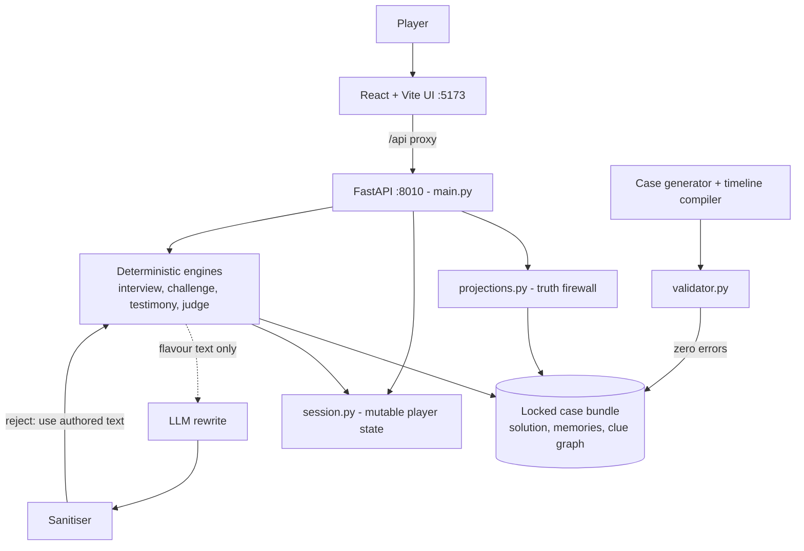
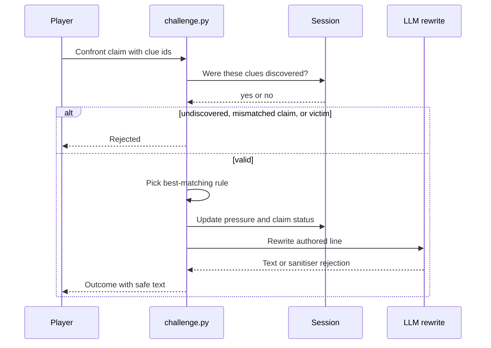

[View Repo :octicons-mark-github-16:](https://github.com/Ready2k/no-one-saw-everything){ .md-button }

# No One Saw Everything — Fair-Play Murder Mystery

**TL;DR:** A Smallville-style murder mystery in which the player arrives after the crime, rewinds the morning, interrogates villagers, and builds a case on a board. The truth is generated and locked before play, and the API never leaks it. LLMs add procedural cases and narrative flavour but never decide what is true.

**Stack:** Python • FastAPI • Pydantic • React 18 • TypeScript • Vite • pytest • Vitest • Playwright • optional OpenAI-compatible LLM (deterministic fallback by default)

---

## ✨ Features

- **⏪ Rewind viewer** - Scrub time ranges, filter by location or sim, and pin events to discover clues
- **🔍 Evidence inspection** - Location searches with prerequisite-gated finds
- **🗂️ Notes and case board** - Manual, contradiction and theory notes, pin-to-suspect, a claims ledger and player-owned suspicion levels
- **🎤 Interview engine** - Six question types with answers grounded in seeded memories and lie state
- **💬 Free-text interrogation** - Typed questions are classified, references are resolved, and the question is routed to the same grounded answers (or casual chat)
- **⚔️ Challenge engine** - Confront a claim with discovered evidence, including one villager's testimony against another's, and get scripted outcomes with pressure tracking
- **⚖️ Accusation judge** - Grades killer, motive, method and opportunity; the truth reveal comes only after an accusation
- **🧬 Procedural generation** - LLM-assisted cases from three templates (blackmail, betrayal, debt), with timelines recompiled per case
- **🛡️ Fairness validator** - `validate_case()` gates every case, hand-authored or generated
- **🗺️ Playtest tooling** - Session telemetry, hints, playtest export and a dev map editor

---

## 🧠 Architecture

---

## 🎯 What Makes This Special

### Truth first, flavour second
The case is a locked Pydantic model, and the engines compute every outcome deterministically before an LLM sees anything. The LLM is then asked only to rewrite surface dialogue, and a sanitiser rejects rewrites that leak role labels, hidden facts outside a precomputed allow-list, or JSON artefacts, falling back to the authored text. The default `fake` provider needs no network, so the full test suite runs offline.

### Fair-play by construction
`projections.py` strips hidden fields at the API boundary, and the reveal is only served after an accusation. Fairness is checked rather than hoped for. `validate_case()` must pass with zero errors, and it exists because cases once shipped invalid. Its checks include a ban on routine summaries that leak the plot, and the suite has dedicated no-leak tests for projections, LLM dialogue, free-text interviews, generated-case endpoints and open-ended questions.

### Testimony as evidence
The title promises that nobody saw everything, so one villager's word can be used against another's. `testimony.py` settles whether two statements can both be true. The same person in two places within 5 minutes is a bilocation, and an opposite-polarity claim about the same place within 20 minutes is a denial. The tolerances are deliberately conservative, because a detector that cries wolf teaches players to ignore it.

### Generated cases that are not reskins
A template-only generator replays the same morning every time. In `llm_assisted` mode a timeline phase writes new ambient beats, and `timeline_compiler` keeps the murder and every clue-bearing event untouched. It reserves agent-minute slots so nobody is ever in two places, and on any failure it keeps the template. The invariants live in the compiler, not in the LLM prompt.

---

## 🚀 Technical Highlights

### Backend
- Three-way split: immutable case bundle (`case_store.py`), mutable per-session state (`session.py`), and player-safe views (`projections.py`)
- `challenge._find_rule` ranks by fully-supplied trigger, then outcome severity, then evidence overlap, so more evidence never yields a weaker response
- LLM config precedence: saved settings override env vars; providers are `fake`, `auto` and `openai_compatible`, with SSRF guarding in `http_safety.py`
- Interview rules that silently never match are caught by a reachability test

### Frontend
- Views for Rewind, Suspects, Places, Board, Accuse and a case library, plus an accusation ceremony and reveal breakdown
- Layered location scenes, a map replay, composure meters, and audio via Howler
- Vitest unit tests plus a Playwright golden-path e2e spec

### Quality
- pytest doubles as the case-fairness validator, including a golden solve path that plays a case end to end
- Verdict bands account for correctness, so naming the right killer never reads as "wrong suspect"

---

## 📊 Key Metrics

- **Backend tests**: 748 passed (full run in about 40 seconds) across 70 test files
- **Frontend**: 70 TypeScript files, about 22,100 lines; 4 Vitest files and 1 Playwright spec
- **Backend**: about 12,900 lines in `app/*.py` plus about 3,600 in `app/llm/`; 57 API routes in `main.py`
- **Cases**: 8 authored case bundles (16 to 18 agents and 17 to 25 clues each) plus 1 generated; 3 generation templates
- **Spec docs**: 21 markdown design and production docs in `docs/`
- **Dependencies**: 5 lines in `requirements.txt`; 7 runtime npm packages

---

## 🛠️ Development Process

Built phase by phase from a spec pack, from the locked data model through rewind, interview, challenge, judge, generation and free-text interrogation. Later work was driven by playtests (screenshots and QA notes are kept in `playtest-evidence/`), blind reviewer reports per case, and a production audit. Each bug that shipped in content became a validator check or a regression test, which is why the rules above exist.

---

*This project demonstrates designing LLM-assisted systems around a deterministic source of truth, with fairness enforced by validators and tests rather than by prompts.*
