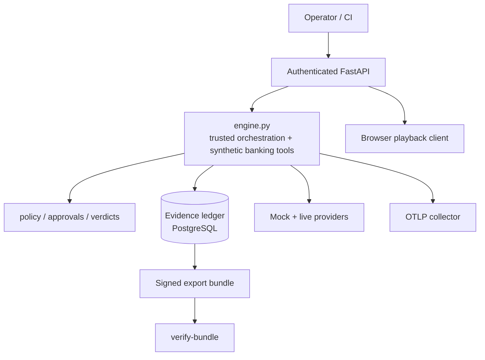
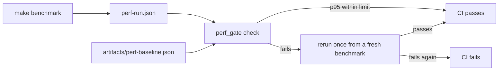

[View Repo :octicons-mark-github-16:](https://github.com/Ready2k/Voice_harness){ .md-button }

# Voice Harness — Voice AI Evaluation & Assurance

**TL;DR:** A container-first, deterministic core for evaluating voice AI in banking. It provides synthetic banking fixtures, a mock provider, a hash-chained evidence ledger and Ed25519-signed export bundles, so every test run produces tamper-evident proof. Live provider adapters sit on top for bake-offs, but the core and CI need no credentials.

**Stack:** Python 3.13 • FastAPI (HTTP + WebSocket) • PostgreSQL 17 (SQLite fallback) • Docker Compose • OpenTelemetry • Ed25519 signing • MCP • Node browser tests

---

## ✨ Features

- **🧾 Evidence ledger** - Append-only and hash-chained, with export manifests (event count, final ledger hash, per-artifact SHA-256) that are Ed25519-signed over RFC 8785 canonical bytes
- **✅ Bundle verification** - `verify-bundle` re-checks event count, final ledger hash and artifact hashes offline against a trusted key ring
- **🛡️ Policy-gated tools** - Protected tool proposals are denied before execution, and approval tokens are single-use and consumed transactionally
- **🔊 PCM playback gate** - Audio playback is bound to session, hash, range and epoch
- **🎙️ Provider bake-offs** - Compare 2 to 6 live configurations (OpenAI, Nova Sonic, xAI, Gemini, ElevenLabs) on the same scenarios, with Wilson-interval scorecards and McNemar head-to-heads computed from the ledgers
- **🎭 Scenario catalogue** - 3 mock built-ins plus 40 live scenarios in five groups: happy path, identity, vulnerable customers, faults and payments
- **🔌 MCP surface** - stdio MCP server and a correlated tool-call gateway
- **📏 Benchmarks and perf gate** - Component benchmarks checked against a committed baseline in CI, plus opt-in load and PostgreSQL-outage chaos tests
- **🔑 Key lifecycle** - Signing keys can be rotated (old public keys stay in a hash-chained history) or revoked, which makes every signature by that key fail

---

## 🧠 Architecture

---

## 🎯 What Makes This Special

### Invariants that fail closed
A failure to write evidence **blocks** tool calls and releases, while a failure to export a trace must not lose ledger data. The asymmetry is deliberate: the ledger is the source of truth, telemetry is a convenience. Contracts (JSON Schema and OpenAPI under `contracts/`) are generated from the pydantic models, and `test_contracts_in_sync.py` fails on any drift because the generator is deterministic.

### Signing that names its own key
The bundle carries a detached envelope of `{algorithm, key_id, payload_sha256, value}`, and the manifest names the same key id and algorithm, so the key choice is itself signed. Verification is offline and only trusts public keys the verifier supplies. If no signer is configured a manifest declares `unsigned_local` rather than pretending otherwise.

### A perf gate tuned for noisy runners
`perf_gate.py` fails a run on any timeout, failure, dropped or discontinuous sample, a short sample (under 1000 observations), a missing profile, or a p95 above `max(baseline x 2.0, baseline + 5 ms)`. The tolerance is wide on purpose: it exists to catch order-of-magnitude regressions such as connection-per-event, not 10% drift. The baseline merges 4 runs and keeps the worst p50/p95 per profile, and a failing CI gate reruns once so a one-off runner stall does not block a merge.

### Honest measurement
Benchmarks are explicitly component measurements, not end-to-end latency. Fixture audio is PCM silence with scripted metadata, so the tests prove enforcement mechanics, not ASR or audibility. The docs say so.

---

## 🚀 Technical Highlights

### Evidence & Storage
- Transactional per-run namespaces over a psycopg pool, with a SQLite fallback for local development
- `chaos_postgres` stops and restarts the database mid-run with client-style retries, and exits 0 only if no evidence was lost, duplicated or unverifiable

### Policy & Contracts
- Pydantic schemas reject unexpected properties; approval-token signing lives in `approvals.py`
- 135 generated contract files cover events, tools and approval tokens

### Supply Chain
- Dependencies are pinned in `pyproject.toml` and hash-locked in `requirements.lock`
- The Python, Node, PostgreSQL and OTel collector images are all pinned by digest
- Tests run in a non-root container against real PostgreSQL

### Testing & CI
- `unittest` suite plus Node browser tests; the GitHub Actions workflow runs `make test` then `make perf-gate`

---

## 📊 Key Metrics

- **Python source**: 129 modules, about 31,000 lines in `src/voice_harness/`
- **Tests**: 90 Python test files with 1,212 test methods, plus 18 Node browser test files with 195 `test`/`it` cases
- **Acceptance gates**: AC-01 to AC-21, mapped in `docs/PHASE1_STATUS.md`
- **Scenarios**: 40 live catalogue scenarios, plus 3 mock built-ins
- **Bake-off scale**: up to 6 providers x 40 scenarios x 3 repetitions, which is 720 cells; the full set has been run
- **Perf baseline**: 15 profiles (12 component, 3 WebSocket), 1000 observations each; the single-session component p95 is about 2.9 ms
- **Docs**: 56 Markdown files in `docs/`, including the v0.3 spec of 1,159 lines
- **Commits**: 344 over 19 days (16 Oct to 3 Nov 2026)

---

## 🛠️ Development Process

Built from a written spec (`docs/voice_evals_spec_v0.3.md`) with phased status documents (PHASE1 to PHASE6) and repeated code-versus-spec rechecks, each recorded as a dated document. Claims are tied to acceptance gates, and benchmark artifacts are committed with their provenance. The reproducible CI path uses only the mock provider, while live bake-offs are opt-in runs whose reports are kept under `artifacts/`.

---

*This project demonstrates assurance engineering for AI: auditable evidence, deterministic fixtures and security-first design. It reuses audited pieces of the [Voice S2S Platform](pr7_VoiceS2S.md).*
