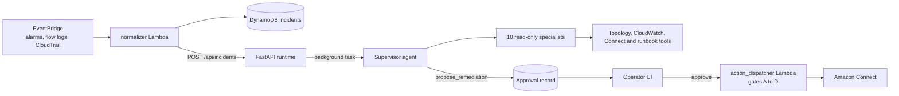
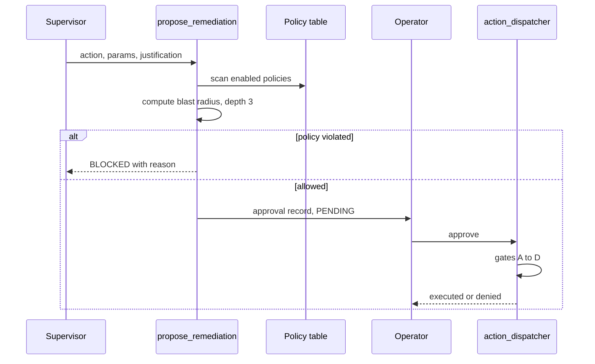

[View Repo :octicons-mark-github-16:](https://github.com/Ready2k/Connect_SRE){ .md-button }

# Connect SRE Agent — AI Operations for Amazon Connect

**TL;DR:** A domain-specific SRE platform for Amazon Connect. It detects contact-flow regressions, correlates infrastructure changes with incidents, calculates blast radius and recommends safe remediation. A supervisor agent coordinates 10 read-only specialists. Writes to Connect are off by default, and every change passes an operator approval and a policy gate before it runs.

**Stack:** Python • FastAPI • Google ADK (Gemini) • AWS Strands (Bedrock Claude) • Lambda • EventBridge • DynamoDB • SQS • CloudFormation • ECS Fargate • React 19 + Vite • Docker

---

## ✨ Features

- **🧠 10 specialist agents** - FLOW, MODULE, QUEUE, LEXA, AIA, CHANGE, IMPACT, RUNBOOK, RISK and VERIFY, each scoped to a subset of tools
- **🔀 Two model paths** - Gemini via ADK or Claude on Bedrock via Strands, switched with the `MODEL_PROVIDER` variable
- **🗺️ Topology graph** - A scanner Lambda crawls Connect APIs into a DynamoDB adjacency list, so blast radius is a graph traversal
- **✋ Human approval** - Only the supervisor can call `propose_remediation`; the operator approves in the UI before the dispatcher Lambda will act
- **📡 Event ingestion** - CloudWatch alarms, Connect flow logs and CloudTrail mutations are normalised, de-duplicated and turned into incidents
- **🧾 Investigation memory** - `recall_prior_incidents` and `record_investigation_memory` let agents reuse earlier findings
- **📚 Seeded policies and runbooks** - Policies, tool registry, journeys and 7 runbooks are loaded by seed scripts
- **🎛️ 14-page operator UI** - Incidents, approvals, topology, monitoring, agent swarm, Connect AI agents, policy and runbooks
- **🔁 Demo and live modes** - A header toggle switches most endpoints between mock data and real AWS and Connect APIs

---

## 🧠 Architecture

---

## 🎯 What Makes This Special

### Policy enforced twice, in code
Safety does not live in the prompt. `propose_remediation` reads the enabled policies from DynamoDB and can return `BLOCKED` before any ticket exists: out-of-hours deployments (22:00-06:00 UTC), and a max blast radius of 20% of topology nodes. The dispatcher Lambda then applies four independent gates: Connect writes enabled (A), high-risk actions need an approval ticket (B), autonomous operation needs its own flag (C), and the ticket must be marked `APPROVED` (D). A confused model cannot skip either layer.

### One toolset, two agent frameworks
Tools in `runtime/tools.py` are plain typed Python functions with docstrings, so the same implementations run under Google ADK and AWS Strands without modification. `agent.py` picks the provider at import time. On Strands, `agents_bedrock.py` builds each specialist as an `Agent` wrapped in `@tool`, and gives only the supervisor `propose_remediation`, so specialists stay read-only by construction. Adding a specialist takes a prompt, an agent wrapper and a supervisor persona entry.

### Blast radius as a graph query
The topology scanner stores nodes and edges as an adjacency list: `nodeId` plus `edgeTypeTarget`, with `DEPENDS_ON#` and `REQUIRED_BY#` edge prefixes. Blast radius is a depth-limited upstream traversal, and the result is attached to the approval record so the operator sees impacted nodes next to the proposed action.

### Realistic operational constraints
The repo includes scripted Lambda deploys, synthetic alarm tests and a dev-IP security group updater. It also documents the real constraints: the topology scanner must run before blast radius is meaningful, and alarms must carry Connect resource dimensions to be correlated.

---

## 🚀 Technical Highlights

### Agent runtime
- `_BedrockSupervisor.chat()` runs the synchronous Strands agent in a thread-pool executor so FastAPI's event loop is never blocked
- Investigations run as FastAPI background tasks, so the normalizer's POST returns immediately
- `_compress_tool_output` passes tool payloads through `headroom` before the agent sees them, falling back to the raw payload on any error
- Defaults: `gemini-3.5-flash` for ADK, `us.anthropic.claude-sonnet-4-6` for Bedrock

### Event pipeline and data
- `normalizer.py` de-duplicates within `DEDUPE_WINDOW_MINUTES` and triggers a topology refresh on CloudTrail mutations
- 11 DynamoDB tables cover incidents, approvals, policy, topology, agent runs, agent steps, journeys, tool registry and memory; agent steps expire after 90 days
- Approvals move through `PENDING`, `AUTO_APPROVED`, approved or rejected; a SEV4 policy can auto-approve low-severity changes

### Infrastructure
- One CloudFormation template defines the VPC, ALB, ECS Fargate service, Lambda roles, DynamoDB tables, EventBridge rules and SQS queues
- Feature flags `EnableConnectWriteActions` and `EnableAutonomousActions` both default to `false`
- A flow-log subscription filter is only created when `PrimaryConnectInstanceId` is supplied

---

## 📊 Key Metrics

- **Agents**: 1 supervisor plus 10 specialists, 17 tool functions in `tools.py`
- **API**: 38 route handlers in `runtime/main.py` (1,988 lines)
- **Code**: about 4,100 lines of runtime Python, 1,700 lines of Lambda and seed Python, 4,550 lines of UI JSX across 28 files
- **Infrastructure**: 1,452-line CloudFormation template with 11 DynamoDB tables, 3 Lambda functions, 6 EventBridge rules, 2 SQS queues
- **Operations**: 13 deploy, seed and test scripts; 9 seeded policies; 7 runbooks
- **Docs**: 1,800-line `SPEC.md` plus 6 documents in `docs/`
- **Tests**: `test_agent.py` has 4 checks (tool signatures, Strands registry, supervisor build, live Bedrock call)

---

## 🛠️ Development Process

The project is spec-driven: `SPEC.md` and the architecture, policy-model, topology and runbook-authoring documents in `docs/` define the design, and the repo carries a `CLAUDE.md` for Claude Code. Each Lambda has its own deploy script and a synthetic test script, so infrastructure changes can be exercised without waiting for a real incident.

---

*This project demonstrates multi-agent orchestration, event-driven AWS architecture and layered safe-autonomy patterns for operations.*
