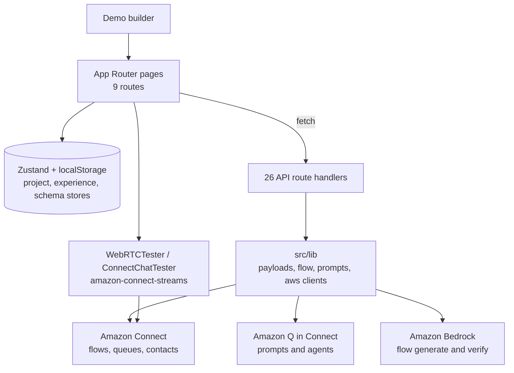
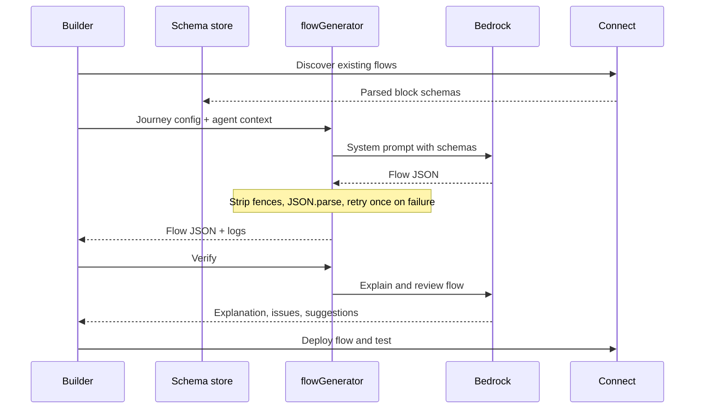

[View Repo :octicons-mark-github-16:](https://github.com/Ready2k/Connect_AI_Demo_Configurator){ .md-button }

# Connect AI Agent Demo Builder

**TL;DR:** A local Next.js tool for configuring, previewing, deploying and live-testing an Amazon Q in Connect AI agent demo. It manages two agents (`CustomerIntentRouter` and `LostCard`), builds the AWS SDK payloads, and uses Bedrock to generate Contact Flow JSON from a journey config. A banking lost-card scenario with simulated tool failures drives the demo.

**Stack:** Next.js 16 • React 19 • TypeScript • Tailwind CSS 4 • Zustand • Zod • AWS SDK (qconnect, connect, connectparticipant, bedrock-runtime, sts) • amazon-connect-streams • Amazon Chime SDK • React Flow (`@xyflow/react`)

---

## ✨ Features

- **⚙️ Settings and agents** - Configure region, assistant ID, Connect instance and deployment mode, and edit both agent prompts with YAML validation and reset-to-default
- **👀 Preview and dry run** - Inspect the generated prompt and agent payloads before anything touches AWS
- **🚀 Staged deploy** - Four modes: `preview_only`, `create_prompts_only`, `create_agents_only`, `create_prompts_and_agents`, with duplicate detection and step-by-step progress
- **🎭 Failure simulation** - Nine demo modes, such as `lookup_stage_failure`, `tool_failure_at_block_card` and `full_success_simulation`, plus eight mock banking tools
- **🔎 Flow discovery** - Fetch real Connect flows and parse their block schemas into a reusable library
- **🧩 Experience builder** - Configure a journey and routing rules, generate Contact Flow JSON via Bedrock, then deploy it
- **✅ Flow verification** - A second Bedrock call explains the generated flow in plain English and lists issues and suggestions
- **🗺️ Flow canvas** - Read-only React Flow graph of the generated Contact Flow
- **📞 Live testing** - Test through WebRTC voice or Connect chat directly in the tool
- **📐 Documented architecture** - C4 levels 1 to 3 plus key data flows in `docs/architecture.md`

---

## 🧠 Architecture

The experience flow is a generate, verify, deploy loop:

---

## 🎯 What Makes This Special

### Schemas learned from real flows
Connect's Contact Flow block format is large and under-documented, so the tool does not hard-code it. `schemaParser.ts` parses flows fetched from the user's own instance, extracts block schemas into a library, and `flowGenerator.ts` serialises that library into the Bedrock system prompt. The model is constrained to block shapes that exist in the target instance.

### Agent context in the prompt
The generator also receives the entry agent's name, description, system prompt and tool list. Compare-block conditions can then use the exact tool names the agent signals through session attributes, instead of invented values.

### Defensive handling of model output
Generated JSON is stripped of markdown fences and parsed. On failure it is retried once with the parse error fed back, and every step is logged. Verification returns an explicit error when the model's reply is not valid JSON, so unreliable output is flagged rather than shown as fact.

### No server-side state
Configuration lives in persisted Zustand stores in the browser. AWS credentials come from the host's default credential chain and stay in the API routes, so the browser never holds them.

---

## 🚀 Technical Highlights

### Frontend
- Four Zustand stores: `projectStore`, `experienceStore` and `schemaStore` persisted to localStorage, and an ephemeral `logStore`
- Zod schemas (`src/lib/config/schema.ts`) validate project config, deployment modes and name-suffix modes
- `WebRTCTester` reaches `window.connect.RTCSession` from `amazon-connect-streams` at call time and shows a clear error if the global is missing, because `amazon-connect-rtc-js` does not exist on npm (recorded in `BUILD_LOG.md`)

### API layer
- 26 route handlers wrap Q in Connect, Connect and Bedrock, including chat start, message and transcript, DTMF, queues, phone numbers, Lex bots and a streaming Bedrock chat
- `deployService.ts` paginates existing prompts and agents to detect duplicates, and resolves the account ID through STS when an agent ARN must be built
- `validatePromptYaml` checks for a top-level `messages` array before deploy

### Docs and IAM
- `IAM_PERMISSIONS.md` and `iam-policy.json` document the permissions the tool needs
- Separate prerequisites and troubleshooting guides sit alongside the C4 architecture doc

---

## 📊 Key Metrics

- **Source**: 74 TypeScript files, 9,345 lines under `src/`
- **Routes**: 9 pages and 26 API route handlers
- **Agents**: 2 managed Q in Connect agents and 8 mock tools
- **Simulation**: 9 demo failure and success modes, 4 deployment modes
- **Dependencies**: 16 runtime and 10 dev packages
- **Docs**: 4 docs files (567 lines), IAM guide and policy
- **Tests**: No automated test suite; verification is via `npm run build` and lint

---

## 🛠️ Development Process

Built in phases recorded in `BUILD_LOG.md`: packages, foundation, flow discovery, experience builder, WebRTC tester, then navigation and dashboard. The log notes each phase's build status and the blockers hit along the way. The final entry records a passing `npm run build`. It also records 63 lint errors and 5 warnings that pre-date the experience work. `AGENTS.md` warns the coding agent that this Next.js version has breaking changes and to read the bundled docs first.

---

*This project demonstrates tooling for AI-agent demos on Amazon Connect: generative flow authoring, schema discovery and an end-to-end deploy-and-test loop.*
