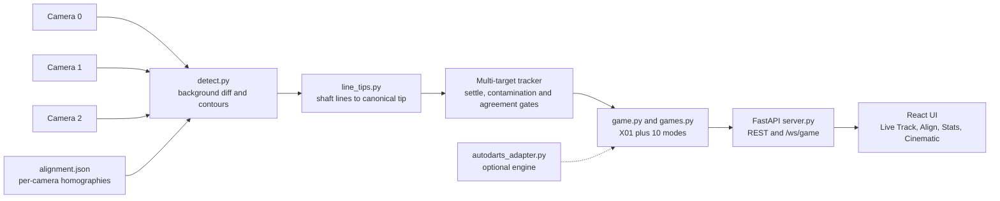
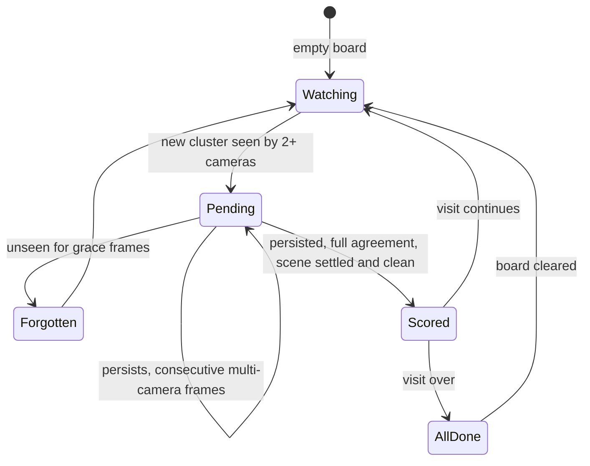

[View Repo :octicons-mark-github-16:](https://github.com/Ready2k/AI_Darts){ .md-button }

# AI Darts — Three-Camera Computer Vision Scoring

**TL;DR:** A darts scoring system that uses three USB cameras and classical computer vision to find where each dart lands. A dart is only scored when several cameras agree on its tip, and a game engine with X01 plus ten other modes sits on top, driving a broadcast-style React UI.

**Stack:** Python • OpenCV • NumPy • FastAPI • WebSocket • React 19 • Vite • Tailwind CSS v4 • Kokoro TTS

---

## ✨ Features

- **📷 Multi-camera detection** - Background subtraction per camera, with each view mapped into a single 500×500 canonical board space by homography
- **🎯 Line-based tip localisation** - Each dart shaft is fitted as a line, warped into board space, and the intersection across cameras gives the true tip
- **🧭 Alignment and auto-calibration** - Drag four diamond handles to fit the board mesh, or auto-fit the board outline as an ellipse and just rotate to line up the numbers
- **🎮 Game engine** - X01 (301/501/701, straight/double/master check-in, double-out, legs and sets) with a checkout solver, plus ten more modes including Cricket, Killer, Shanghai and Around the Clock
- **🤖 AI opponents** - Three skill levels (Gaussian spread of 45, 15 and 6 mm) that pick mode-appropriate targets
- **↩️ Correction controls** - Undo, click-the-board to correct a misread dart, review mode, and background recapture
- **🎬 Cinematic mode** - Walk-on cards, themed rules cards, per-mode scoreboards, confetti, and an MC voice synthesised in the browser
- **📊 Stats and tournaments** - Match history, leaderboard, head-to-head endpoint and a tournament bracket
- **🔌 Pluggable detection** - An adapter lets the Autodarts board manager replace the native vision engine, with a mock server for development without hardware

---

## 🧠 Architecture

The tracker is the part worth a second diagram. A dart moves through these states before it is allowed to score:

---

## 🎯 What Makes This Special

### Fighting phantoms, not finding darts
Finding a dart is the easy half. Most of the engineering goes into refusing to score things that are not darts: flight ends, a throwing arm, lighting drift. Every candidate sits in a `pending` state and must pass several independent gates before it counts. The scene has to be settled (frame-to-frame foreground change below a threshold), no camera may show more than a maximum number of blobs (an arm shatters into many contours), and the dart must have reached full camera agreement and still have multi-camera support on the confirming frame. When several candidates are ready at once, the tightest spread wins, then camera count, then persistence, so a long-lived edge artifact cannot outrank a fresh real dart.

### Geometry that exploits the flights
Dart flights sit about 10 cm above the board plane, so a homography maps a flight end to a different canonical point in each camera, while the tip, on the plane, lands consistently. The original approach projected both shaft endpoints and clustered them. The current one fits a shaft line per camera and intersects the warped lines, which removes endpoint ambiguity entirely. Cluster tightness is camera-count dependent, because a loose two-camera match is the signature of a phantom.

### Not absorbing darts into the background
An earlier idea was to fold scored darts into the reference image. It created blind spots around them, so a nearby dart was seen by too few cameras and missed. The design now diffs against the empty board only and leaves phantom rejection to the gates. Board-clear is judged relative to the darts-in foreground level, so an arm spiking the signal while pulling darts is not mistaken for a cleared board.

### One interface for every game mode
All eleven games share the X01-compatible interface (`record_hit`, `undo`, `to_dict`, review), created through a `create_game` factory. `to_dict()` carries a per-mode state block, so one scoreboard and cinematic UI render any mode.

---

## 🚀 Technical Highlights

### Vision pipeline
- Detection runs in a background thread and publishes the latest annotated JPEG, so closing the Live Track tab detaches a viewer without losing the background or missing darts
- Tracker thresholds are named constants at the top of `detect.py`, with notes on which direction to move each one
- Warm-up drains frames and averages 30 unique frames for the background; the board mask comes deterministically from the alignment homography
- While the board is empty the background is blended (alpha 0.05) to heal lighting drift

### Backend
- FastAPI streams MJPEG and receives mouse and keyboard events back through event lists the detection worker drains
- A lifespan-managed watcher diffs game state every 100 ms and broadcasts over `/ws/game`, catching both detection-thread scoring and REST mutations
- Per-session logs tee stdout and stderr, with old sessions pruned

### Frontend
- Kokoro TTS runs in-browser via WASM with a managed speech queue, SSML parsing, and a two-tier cache (in-memory LRU and IndexedDB)
- Speech lines have a TTL, so stale commentary is dropped rather than read out late

### Testing
- A replay harness feeds recorded camera sessions through the same `step_tracker` function the live loop calls, so scoring bugs reproduce without cameras
- Unit tests cover the game engines, checkout solver, calibration, consensus clustering, line tips and the Autodarts adapter

---

## 📊 Key Metrics

- **Python source**: 8,289 lines across 23 modules in `src/`
- **Frontend**: 24 JS/JSX files, 9,116 lines
- **Tests**: 8 test files, 1,347 lines
- **Game modes**: 11 (X01 plus 10 in `games.py`)
- **API surface**: 28 REST and WebSocket routes in `server.py`
- **Cameras**: 3 USB cameras into one 500×500 canonical space

---

## 🛠️ Development Process

Built iteratively against a real rig. Each misscore was diagnosed from recorded sessions and turned into a gate, a tuned constant or a replay test. Several approaches were tried and replaced, and the reasons are kept in the project notes so they are not retried.

---

*This project demonstrates applied computer vision, multi-view geometry and robustness engineering for a real-world, noisy physical setup.*
