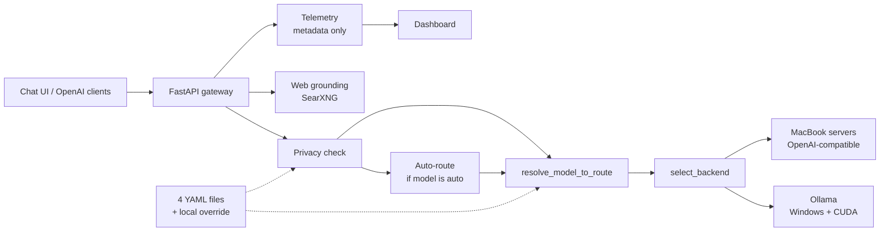
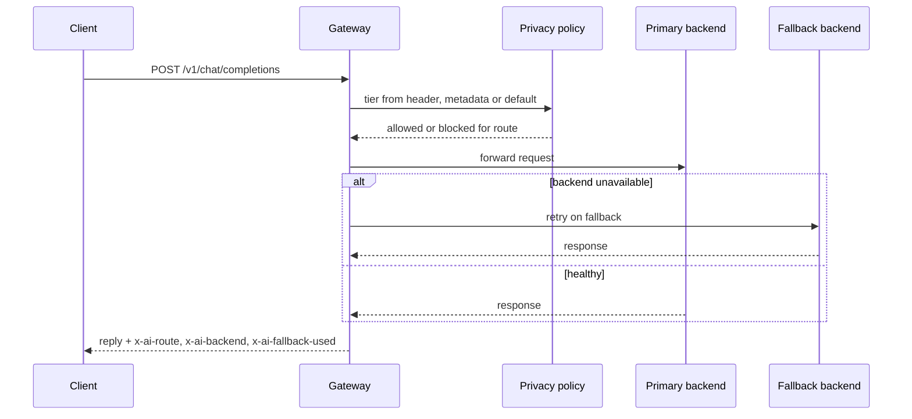

[View Repo :octicons-mark-github-16:](https://github.com/Ready2k/LLM_Machine_checker){ .md-button }

# Local LLM Gateway — Routing Across a Home AI Cluster

**TL;DR:** A lightweight OpenAI-compatible gateway that routes chat requests across a local LLM cluster: Ollama on a Windows/CUDA PC and LM Studio-style servers on a MacBook. Routing, privacy tiers and model aliases live in YAML. It ships a live dashboard and a mobile-first chat UI whose history and memory stay in the browser.

**Stack:** Python • FastAPI • Pydantic • Ollama • LM Studio • YAML policy config • aiosqlite + JSONL telemetry • IndexedDB • SearXNG • trafilatura

---

## ✨ Features

- **🔌 Drop-in API** - `/v1/chat/completions`, `/v1/models` and `/v1/embeddings` work with any OpenAI-compatible client
- **🧭 Policy-based routing** - Five named routes (`local-fast`, `local-quality`, `private-docs`, `local-fast-apple`, `cloud-best`), each with a primary, a fallback and an allowed privacy list
- **🤖 Rule-based auto-routing** - The `auto` alias scores the prompt for privacy, quality and speed signals and picks a route with no LLM call
- **🔒 Privacy tiers** - A request's tier comes from the `x-ai-privacy` header, then `metadata.privacy`, then the configured default. Routes that don't allow the tier are blocked
- **🌐 Web grounding** - The `web` alias searches a self-hosted SearXNG, fetches the top pages and answers from the extracted text with cited sources
- **📊 Observability dashboard** - Backend health, routing events and stats, plus trace, log and audit-export endpoints
- **📱 Mobile-first chat UI** - Served at `/chat/`, with conversation history and long-term memory in IndexedDB
- **📎 Document extraction** - `/chat/extract` pulls text from PDF and DOCX uploads
- **🔐 Optional HTTPS** - Needed for browser microphone access, with a self-signed cert helper
- **🍓 Headless deployment** - A systemd unit and per-node setup scripts, including a Raspberry Pi gateway node

---

## 🧠 Architecture

---

## 🎯 What Makes This Special

### Routing as Pure Config
Backends, routes, model aliases and security rules are four YAML files, and a gitignored `backends.local.yaml` overrides the committed one so LAN addresses never reach the repo. Adding a node or changing which machine serves `local-quality` is an edit, not a deploy. A backend with `inference_enabled: false` is visible on the dashboard but never selected, which is how the utility node is handled.

### Forced RAG Instead of Tool-Calling
Small local models summarise text they are given far more reliably than they decide to call a tool. So web grounding is a fixed retrieve-then-answer step: search SearXNG, fetch the top results, extract readable text and inject it as a strict system message. Sources come back in an `x-ai-sources` header and grounding state in `x-ai-grounding`. Failures degrade to a normal completion rather than an error.

### Privacy That Also Covers the Search Path
SearXNG keeps the query on the LAN, but page fetches leave it. Web grounding is therefore gated separately in `security.yaml` by privacy tier, and a request at a disallowed tier still gets an answer, just ungrounded. `cloud-best` is disabled with `status: not_configured`, and cloud fallback is refused for `restricted` requests regardless of route config.

### A Stateless Gateway With a Stateful Client
Conversation history and long-term memory live in the browser's IndexedDB, so the shared LAN endpoint needs no login and holds no user data. The cost is that history doesn't follow you between devices. That is a deliberate trade for a household service used mostly from phones.

---

## 🚀 Technical Highlights

### Routing and Policy
- `routing.py` (`resolve_model_to_route`, `select_backend`) is pure config logic with no I/O, so it is directly unit-testable
- `autoroute.py` scores regex signal lists: any privacy hit goes to `private-docs`, two or more quality hits or a prompt of 400+ characters goes to `local-quality`, and short or fast-signal prompts go to `local-fast`
- A `confidential` or `restricted` privacy header overrides content scanning
- Every response carries `x-ai-route`, `x-ai-backend`, `x-ai-model`, `x-ai-fallback-used` and `x-ai-policy`, plus `x-ai-auto-reason` for auto-routed requests

### Providers and Telemetry
- An abstract `Provider` base with Ollama, LM Studio and generic OpenAI-compatible implementations
- Telemetry records routing metadata to JSONL and two SQLite tables (`llm_requests`, `llm_events`), and prompt content is never logged (`prompt_logging_enabled: false`)

### Chat Client
- Plain ES modules with no build step: `db.js`, `history.js`, `memory.js`, `settings.js` and `app.js`
- Shell height follows `window.visualViewport` so the composer stays above the iOS soft keyboard. Form fields are 16px on mobile to stop focus-zoom, and Enter sends only on non-coarse pointers

### Deployment
- Per-role node folders (fast-coder, quality, gateway, hub), a SearXNG docker-compose, and `gateway.service` for systemd
- `manage.sh` starts and stops the gateway and turns on HTTPS automatically when `certs/server.{crt,key}` exist

---

## 📊 Key Metrics

- **Endpoints**: 19 in `server.py` plus 6 observability routes in `api_observability.py`
- **Routes / aliases**: 5 routes, 10 model aliases, 4 backends (3 inference-enabled, 1 utility node)
- **Code**: 2,282 lines of Python in `gateway/` and 970 in `tests/`; about 2,100 lines of chat client HTML and JS
- **Tests**: 58 test functions across 10 files; `test_live_backends.py` skips itself when LAN nodes are unreachable
- **Spec docs**: 5 in `docs/`, covering the fabric, chat memory, observability, Open WebUI and dashboard plan
- **Dependencies**: 11 packages in `requirements.txt`

---

## 🛠️ Development Process

The design started from the spec docs in `docs/`, then grew outward from the routing core to the dashboard, the chat client and the Raspberry Pi deployment. Most tests run offline against the FastAPI app with `httpx`, so routing and privacy rules can be checked without any GPU node being up. Live-backend checks are separate scripts (`check_backends.py`, `smoke_gateway.py`) for when the cluster is running.

---

*This project demonstrates LLM infrastructure: provider abstraction, policy enforcement and privacy-by-design for self-hosted models.*
