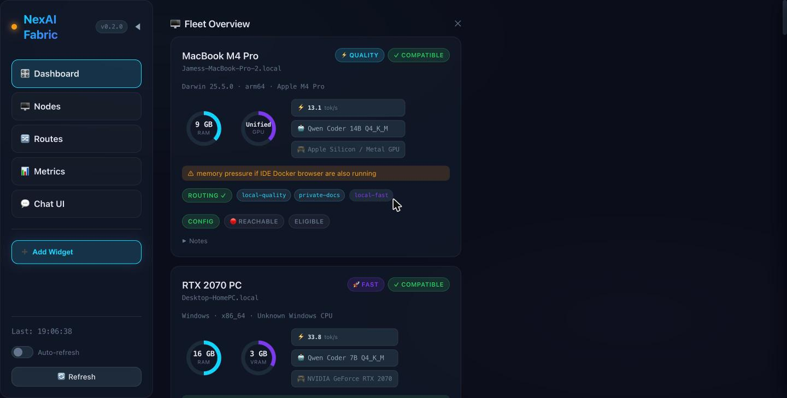
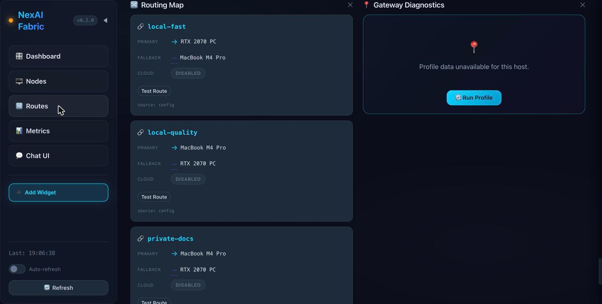
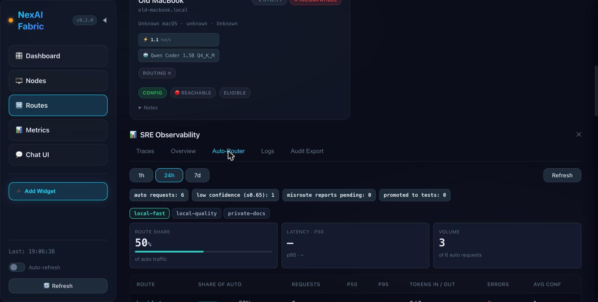
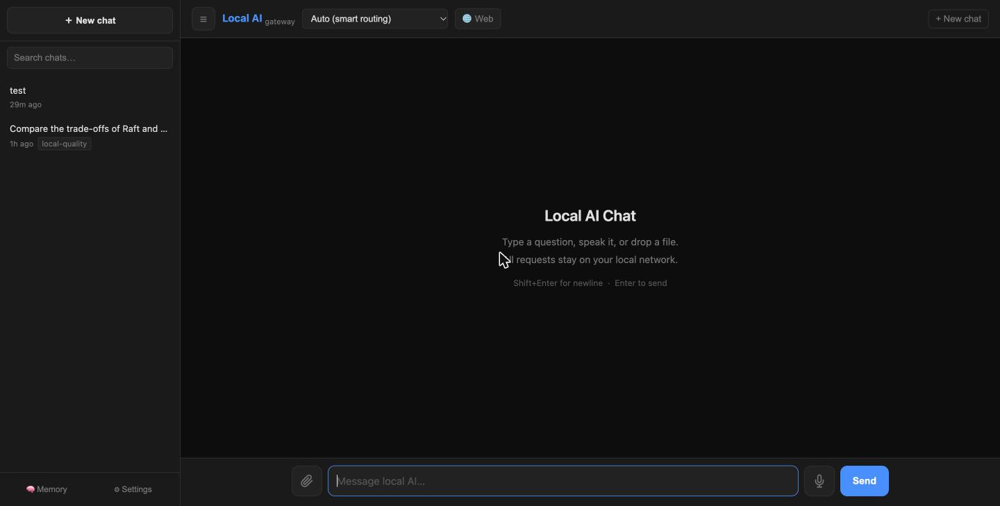
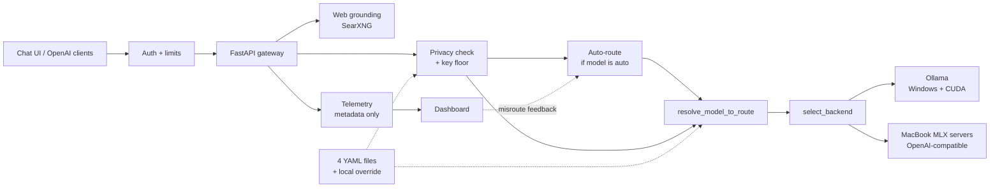
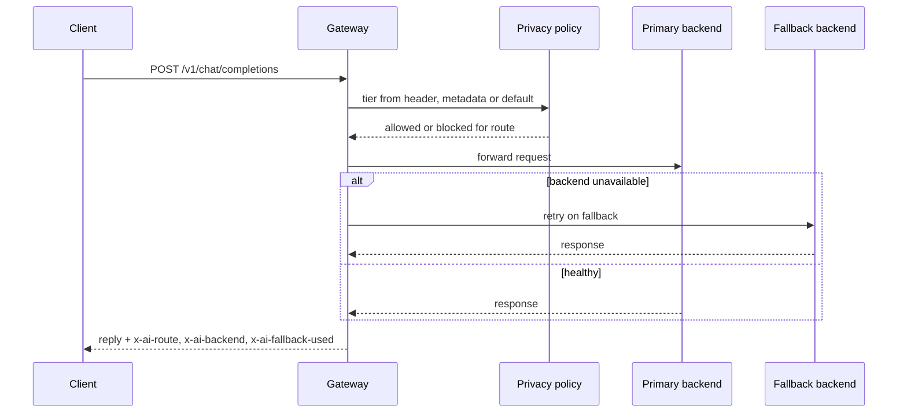

[View Repo :octicons-mark-github-16:](https://github.com/Ready2k/LLM_Machine_checker){ .md-button }

# Local LLM Gateway — Routing Across a Home AI Cluster

**TL;DR:** A lightweight OpenAI-compatible gateway that routes chat requests across a local LLM cluster: Ollama on a Windows/CUDA PC and MLX/LM Studio-style servers on a MacBook. Routing, privacy tiers and model aliases live in YAML. It fails over between nodes at runtime, authenticates LAN clients, and ships a live dashboard with an auto-router feedback loop plus a mobile-first chat UI whose history and memory stay in the browser.

**Stack:** Python • FastAPI • Pydantic • Ollama • LM Studio • YAML policy config • SQLite telemetry • IndexedDB • SearXNG • trafilatura

---

## ✨ Features

- **🔌 Drop-in API** - `/v1/chat/completions`, `/v1/models` and `/v1/embeddings` work with any OpenAI-compatible client
- **🧭 Policy-based routing** - Five named routes (`local-fast`, `local-quality`, `private-docs`, `local-fast-apple`, `cloud-best`), each with a primary, a fallback and an allowed privacy list
- **🤖 Rule-based auto-routing** - The `auto` alias runs a multi-signal classifier (privacy scan, then a weighted complexity score) and picks a route in about 0.05 ms with no LLM call
- **🔁 Runtime failover** - Connect errors, timeouts and 5xx fall through to the fallback backend, including streams that fail before the first chunk
- **🛡️ API-key auth, limits and privacy floors** - Keys are required for non-loopback clients, with body-size, rate and `max_tokens` caps; a key written `key:tier` raises the declared privacy tier
- **🧪 Misroute feedback loop** - A *wrong route?* button in the chat UI and an Auto-Router dashboard tab feed reports that can be promoted into regression tests
- **🔒 Privacy tiers** - A request's tier comes from the `x-ai-privacy` header, then `metadata.privacy`, then the configured default. Routes that don't allow the tier are blocked
- **🌐 Web grounding** - The `web` alias searches a self-hosted SearXNG, fetches the top pages (SSRF-guarded, pinned to the validated IP) and answers from the extracted text with cited sources
- **📊 Observability dashboard** - Backend health, routing events, token usage and stats, plus trace, log, Auto-Router and audit-export views
- **📱 Mobile-first chat UI** - Served at `/chat/`, with conversation history and long-term memory in IndexedDB
- **📎 Document extraction** - `/chat/extract` pulls text from PDF and DOCX uploads
- **🔐 Optional HTTPS** - Needed for browser microphone access, with a self-signed cert helper
- **🍓 Headless deployment** - A systemd unit and per-node setup scripts, including a Raspberry Pi gateway node

---

## 📸 Screenshots

{ loading=lazy }
*Command-center dashboard: per-node health, tokens/sec and the routes each node serves.*

{ loading=lazy }
*Routing map showing primary and fallback node per route.*

{ loading=lazy }
*Auto-Router tab: route share, low-confidence decisions and pending misroute reports.*

{ loading=lazy }
*Mobile-first chat client with smart routing, web toggle, history and memory.*

---

## 🧠 Architecture

---

## 🎯 What Makes This Special

### Routing as Pure Config
Backends, routes, model aliases and security rules are four YAML files, and a gitignored `backends.local.yaml` overrides the committed one so LAN addresses never reach the repo. Adding a node or changing which machine serves `local-quality` is an edit, not a deploy. A backend with `inference_enabled: false` is visible on the dashboard but never selected, which is how the utility node is handled.

### Forced RAG Instead of Tool-Calling
Small local models summarise text they are given far more reliably than they decide to call a tool. So web grounding is a fixed retrieve-then-answer step: search SearXNG, fetch the top results, extract readable text and inject it as a strict system message. Sources come back in an `x-ai-sources` header and grounding state in `x-ai-grounding`. Failures degrade to a normal completion rather than an error.

### Failover and Hardening
`chat_completions` walks `select_backends()` in order and falls through on connect errors, timeouts and 5xx, never on 4xx. Providers share one pooled HTTP client with a 5-second connect timeout, so a dead node is skipped quickly and `x-ai-fallback-used` reports it. Auth is the outermost middleware, so unauthenticated requests never reach the limiter, and loopback stays trusted. Secrets live in a gitignored `.env`, and the node-agent token check is constant-time.

### An Auto-Router That Learns From Its Mistakes
Routing stays deterministic: privacy scan, then a weighted complexity score against a threshold, tunable in `autoroute.yaml` without a restart. The reason header lists signal names and weights only, never matched text. Misroutes are reported from the chat UI or dashboard, keyed by correlation ID, and `./manage.sh feedback promote` turns a report into a test case in the corpus, so fixes become regression tests rather than ad-hoc tweaks.

### Privacy That Also Covers the Search Path
SearXNG keeps the query on the LAN, but page fetches leave it. Web grounding is therefore gated separately in `security.yaml` by privacy tier, and a request at a disallowed tier still gets an answer, just ungrounded. `cloud-best` is disabled with `status: not_configured`, and cloud fallback is refused for `restricted` requests regardless of route config.

### A Stateless Gateway With a Stateful Client
Conversation history and long-term memory live in the browser's IndexedDB, so the shared LAN endpoint needs no login and holds no user data. The cost is that history doesn't follow you between devices. That is a deliberate trade for a household service used mostly from phones.

---

## 🚀 Technical Highlights

### Routing and Policy
- `routing.py` (`resolve_model_to_route`, `select_backend`) is pure config logic with no I/O, so it is directly unit-testable
- `autoroute.py` applies shape-based secret/PII detectors first (ambiguous words like `password` count in prose but not as code tokens), then a weighted complexity score on the last user message against `quality_threshold`; an optional LLM tiebreak is off by default
- A `confidential` or `restricted` privacy header overrides content scanning, and a per-key privacy floor can raise the declared tier
- Every response carries `x-ai-route`, `x-ai-backend`, `x-ai-model`, `x-ai-fallback-used` and `x-ai-policy`, plus `x-ai-auto-reason` for auto-routed requests

### Providers and Telemetry
- An abstract `Provider` base with Ollama, LM Studio and generic OpenAI-compatible implementations
- Telemetry records routing metadata and token usage (including streamed requests, via a `UsageTap` that strips the injected usage chunk) to SQLite tables, and prompt content is never logged
- Config files are mtime-cached, so YAML edits apply without a restart, and health probes run concurrently

### Chat Client
- Plain ES modules with no build step: `db.js`, `history.js`, `memory.js`, `settings.js` and `app.js`
- Shell height follows `window.visualViewport` so the composer stays above the iOS soft keyboard. Form fields are 16px on mobile to stop focus-zoom, and Enter sends only on non-coarse pointers

### Deployment
- Per-role node folders (fast-coder, quality, gateway, hub), a SearXNG docker-compose, and `gateway.service` for systemd
- `manage.sh` starts and stops the gateway, loads secrets from `.env`, runs the `feedback` subcommands and turns on HTTPS automatically when `certs/server.{crt,key}` exist

---

## 📊 Key Metrics

- **Endpoints**: 29 across `server.py`, `api_dashboard.py`, `api_observability.py`, `api_router.py` and `chat_helpers.py`
- **Routes / aliases**: 5 routes, 9 configured model aliases, 4 backends (3 inference-enabled, 1 utility node)
- **Code**: about 4,000 lines of Python in `gateway/` and 3,100 in `tests/`; about 5,900 lines of dashboard and chat client HTML, JS and CSS
- **Tests**: 218 test functions across 27 files; `test_live_backends.py` skips itself when LAN nodes are unreachable
- **Spec docs**: 5 in `docs/`, covering the fabric, chat memory, observability, Open WebUI and dashboard plan
- **Dependencies**: 12 packages in `requirements.txt`

---

## 🛠️ Development Process

The design started from the spec docs in `docs/`, then grew outward from the routing core to the dashboard, the chat client and the Raspberry Pi deployment. A later hardening pass added auth, limits, failover, SSRF pinning and token telemetry, followed by the auto-router rewrite and its feedback loop. Most tests run offline against the FastAPI app with `httpx`, so routing and privacy rules can be checked without any GPU node being up. Live-backend checks are separate scripts (`check_backends.py`, `smoke_gateway.py`) for when the cluster is running.

---

*This project demonstrates LLM infrastructure: provider abstraction, policy enforcement and privacy-by-design for self-hosted models.*
