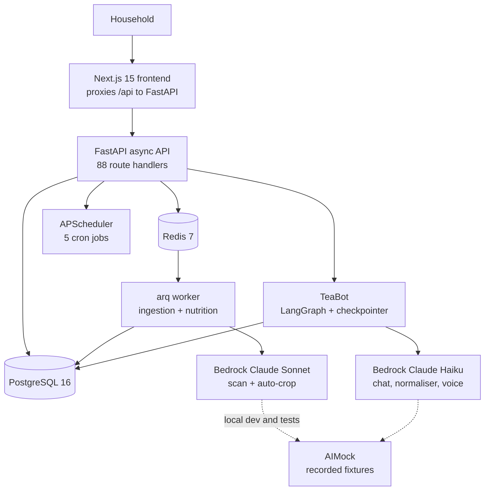
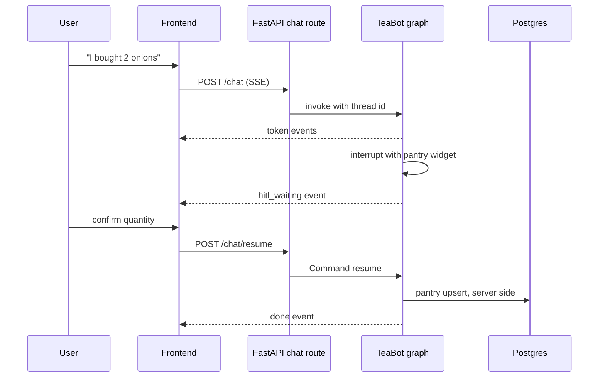

[View Repo :octicons-mark-github-16:](https://github.com/ready2k/whatsfortea){ .md-button }

# WhatsForTea — Kitchen Assistant for the NAS

**TL;DR:** A self-hosted recipe manager that digitises physical recipe cards with a vision model, then answers one question: *what can I actually cook tonight, given what is in my kitchen right now?* Pantry stock is tracked as a confidence value that decays over time, recipes are scored against it, and a LangGraph chat assistant (TeaBot) can act on the pantry with human approval. It runs as Docker containers on a Synology NAS.

**Stack:** Python 3.12 • FastAPI • Next.js 15 • PostgreSQL 16 • Redis 7 • LangGraph • AWS Bedrock (Claude Sonnet and Haiku) • APScheduler • arq • Docker Compose

---

## ✨ Features

- **📸 Recipe card scanning** - Photos of a card's front and back go to a Claude vision model, which extracts ingredients, steps and per-step crop boxes; a review step flags unresolved ingredients before saving
- **🔗 More import routes** - Recipe URL import, receipt scanning and barcode lookup (Open Food Facts, cached in Redis)
- **🥫 Confidence-based pantry** - Items carry a confidence multiplier, decay daily by category, and can switch to expiry-date-driven confidence
- **🍳 Hangry matcher** - Every recipe gets a 0-100 score from pantry availability, bucketed into Cook Now, Almost There and Planner, plus a "use it up" re-ranking mode
- **🗓️ Meal planning and shopping** - Week planner with auto-fill, shopping list with pack-size rounding rules
- **🤖 TeaBot** - LangGraph chat agent with a Postgres checkpointer, SSE streaming and human-in-the-loop pantry updates
- **🎙️ Voice commands and nutrition** - Haiku-backed intent parsing and nutrition estimates
- **👨‍👩‍👧 Households** - JWT cookie auth, invite codes, per-household data and password reset
- **📱 PWA touches** - Push notifications, offline banner, step timers

---

## 🧠 Architecture

TeaBot's pantry write is the one place the model proposes a change to data, so its flow is worth showing:

---

## 🎯 What Makes This Special

### Confidence instead of counts
Nobody weighs their flour. Pantry items store a quantity and a confidence, and the usable amount is `quantity × confidence`. A daily job lowers confidence (fridge items by 0.1, pantry items by 0.02), and when an expiry date is known, confidence follows days remaining against category shelf life instead. The matcher then scores each ingredient as `min(available / required, 1.0)` and averages, so "probably have it" counts for partial credit rather than failing a binary check.

### Model tiering through configuration
Vision work (card scanning, auto-crop) routes to Claude Sonnet; routine text work (TeaBot, normaliser, nutrition, voice) routes to Haiku. The split lives in one function, `_model_id(vision=...)`, driven by two environment variables, and prompts are Jinja2 templates in `agent_config/` rather than Python strings. Swapping a model or editing a prompt needs no code change.

### The model proposes, the server writes
TeaBot never mutates the pantry directly. A pantry confirmation calls LangGraph's `interrupt()`, the stream emits `hitl_waiting`, and only `/chat/resume` with the user's decision triggers the upsert, executed server-side. The Postgres checkpointer keeps the thread alive across requests, history is trimmed to the last 20 messages, and context is capped at 150 recipes with full ingredient detail for only the top 8 pantry matches.

### Home-lab pragmatism
Scheduling is APScheduler inside the API process, with no Celery; the heavier ingestion and nutrition jobs go to a small arq worker on the existing Redis. Images are built for linux/amd64 with buildx and pulled on the NAS, where a nightly job backs up to a mounted volume.

---

## 🚀 Technical Highlights

### Backend
- Four-layer ingredient normaliser: alias lookup, `rapidfuzz` fuzzy match (auto-accept at 0.85), LLM assist below 0.60, then user overrides persisted as aliases
- Uniform error envelope with `SCREAMING_SNAKE_CASE` codes defined in one `errors.py`
- Raw LLM responses stored in a separate `llm_outputs` table with a nightly cleanup job
- Reservations table prevents the planner and an active cooking session double-counting the same stock

### Frontend
- Next.js App Router with React Query; `next.config.ts` rewrites `/api/*` so the browser only talks to one container
- TeaBot panel handles the SSE stream and renders human-in-the-loop confirmation widgets
- Barcode scanning via the `BarcodeDetector` API with a manual-entry fallback

### Infrastructure and testing
- Dev compose runs db, redis, api, worker, frontend and aimock; the Synology compose pulls prebuilt images for db, redis, api, worker and frontend
- AIMock replays recorded Bedrock responses, so tests run without AWS credentials; `make record-fixtures` refreshes them
- CI runs Gitleaks secret scanning plus backend tests against real Postgres and Redis service containers

---

## 📊 Key Metrics

- **API surface**: 88 route handlers across 15 router modules under `/api/v1`
- **Backend size**: 10,087 lines of Python in `backend/app`; 12,820 lines of TypeScript in `frontend/src`
- **Tests**: 98 test functions across 9 test files, plus a 55-ingredient golden normaliser set
- **Data model**: 22 Alembic migrations
- **Scheduled jobs**: 5 (decay, expiry check, LLM cleanup, empty-plan check, nightly backup)
- **LLM prompts**: 6 Jinja2 templates plus an editable settings YAML
- **Specs**: 4 documents in `spec/` plus a product overview

---

## 🛠️ Development Process

Built with Claude Code against a written specification (`spec/original_spec.md`) and a phased plan: ten core phases followed by four post-v1 tiers, tracked in a checkpoint document. A competitive appraisal and a "what's next" backlog sit alongside the code. The repository has 137 commits, and ruff, bandit and ESLint are part of the documented pre-push checks.

---

*This project demonstrates a practical, multimodal GenAI application built for self-hosted deployment, where confidence scoring, model tiering and human approval gates keep the AI useful and the data trustworthy.*
