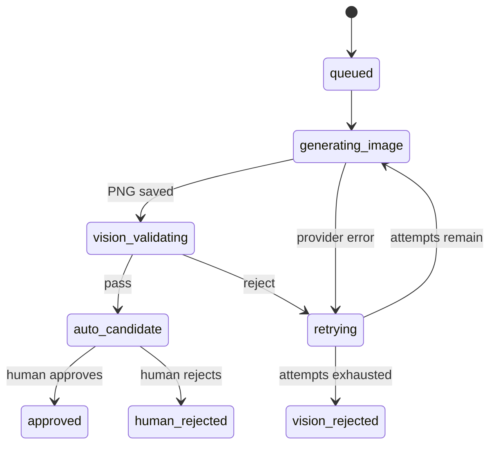

[View Repo :octicons-mark-github-16:](https://github.com/Ready2k/my_Physio){ .md-button }

# Physio — Exercise Illustrations with a Generation Pipeline

**TL;DR:** A Next.js 16 physio app backed by an internal Asset Lab. Exercise instructions are extracted from web pages with Gemini, then a queue-driven pipeline generates consistent illustrations locally with SDXL via ComfyUI. Each image is checked by Gemini vision and only becomes an app asset after human sign-off.

**Stack:** Next.js 16 • React 19 • TypeScript • Tailwind 4 • Framer Motion • ComfyUI • SDXL (IP-Adapter + ControlNet) • Gemini 2.5 Flash • JSON file persistence

---

## ✨ Features

- **🌐 Exercise extraction** - `/api/extract` scrapes a page with cheerio and asks Gemini to turn it into structured exercises and steps, stored in `exerciseLibrary.json`
- **🧍 Locked personas** - Two persona definitions (`fitness_female_v1`, `fitness_male_v1`) and shared style and negative-prompt constants keep every illustration on-model
- **🖼️ Master references** - The first approved asset for a persona becomes the IP-Adapter reference for all later generations
- **🦴 Pose control** - Registered OpenPose skeletons condition each frame, and an in-browser canvas editor lets you drag 18 joints to author new ones
- **🧪 Workflow tiers** - Reference plus pose, reference only, or text only, chosen by probing ComfyUI's `/object_info` for the required custom nodes
- **🔍 Vision QA** - Gemini 2.5 Flash returns `pass`, `pass_with_warnings` or `reject` against a hard-failure rubric (wrong pose, cropped body, extra limbs, photorealism, watermark)
- **✅ Human approval** - Vision-passed images stay `auto_candidate` until approved in the Asset Lab, which moves the file from `generated/` to `approved/`
- **🔁 Job queue** - File-backed jobs with deduplication, three attempts per job, and a worker that pauses when ComfyUI is unreachable
- **🧰 Safe dev mode** - A mock image provider is the default, so the app runs without a GPU or API key

---

## 🧠 Architecture

```mermaid
flowchart LR
    Extract["/api/extract<br/>cheerio + Gemini"] --> Lib[exerciseLibrary.json]
    Lib --> Queue[generationQueue.ts<br/>generationJobs.json]
    Queue --> Worker[generationWorker.ts]
    Worker --> Pose[poseControlCatalogue.json]
    Worker --> Ref[Persona master reference]
    Pose --> Comfy["LocalComfyProvider<br/>SDXL workflow"]
    Ref --> Comfy
    Comfy --> PNG[Generated PNG]
    PNG --> QA[Gemini vision QA]
    QA -->|pass| Cand[auto_candidate]
    QA -->|reject| Retry[retry or vision_rejected]
    Cand --> Lab[Asset Lab review]
    Lab --> Cat[assetCatalogue.json<br/>approved asset]
    Cat --> App[Main app]
```

Job and asset state machine:

---

## 🎯 What Makes This Special

### Diagnose by Model Family, Not by Prompt
Output quality depends on which model family actually resolved. `LocalComfyProvider.getModelConfig()` checks, in order, a `FORCE_SD15` override, the `IMAGE_MODEL_FAMILY` env var, a per-request override, then defaults to SDXL (or Flux for `.gguf` checkpoints). One stale environment variable can silently force an older model, so the project's rule is to check the logged family before touching prompts.

### Identity Through Constraints
Consistency does not rely on one clever prompt. Persona text, illustration style and negative prompts live in `assetPrompts.ts`, a reference image anchors the face and outfit via IP-Adapter, and a pose skeleton fixes the body. Each of the three layers narrows what the model can vary.

### Layered Gates With a Human Last
Gemini vision rejects hard failures before a person sees an image, which shrinks the review pile. It can still be wrong, so `auto_candidate` assets are hidden from the app unless `SHOW_AUTO_CANDIDATES=true`. Approval is a deliberate human act.

### Failure Handling That Protects the Queue
A job gets three attempts. A ComfyUI connection failure also breaks the worker loop, because otherwise one offline server would burn every job's retries in seconds. Deduplication refuses a job when an active one exists for the same asset, or when a usable asset is already in the catalogue.

---

## 🚀 Technical Highlights

### Generation Layer
- `localComfyProvider.ts` (422 lines) patches a workflow JSON template with prompt, seed and filenames, submits it to `/prompt`, polls `/history/{id}` and downloads the PNG
- 9 workflow templates in `workflows/comfy/` covering SDXL, SD1.5 and Flux Schnell variants
- Input images reach ComfyUI by file copy into `services/ComfyUI/input/`

### Pipeline Layer
- `generationWorker.ts` resolves a pose control by `frame_key` or exercise name, fetches the persona master reference, generates, validates, then writes the catalogue entry
- Vision parse failures and API errors are treated as `reject`, so a QA outage cannot let unchecked images through
- Horizontal exercises get extra rubric rules, such as rejecting a standing figure

### Data and API Layer
- No database: three JSON files in `src/data/` hold the assets, pose controls and jobs, plus `exerciseLibrary.json` for extracted content
- 17 Next.js route handlers cover assets, jobs (cancel, retry, reject), pose controls, approval, master promotion and extraction

### Asset Lab UI
- `/asset-lab` is a 1,276-line page for job monitoring, candidate review and pose registration, with a 334-line canvas `PoseGenerator.tsx`
- The route is internal tooling and must not be exposed publicly

---

## 📊 Key Metrics

- **Source**: 31 TypeScript files, 4,637 lines in `src/`
- **API routes**: 17 route handlers
- **Workflow templates**: 9 ComfyUI JSONs
- **Catalogue**: 101 assets (98 female persona, 3 male), of which 6 approved, 92 `auto_candidate` and 3 `human_rejected`
- **Pose controls**: 58 registered, 134 skeleton PNGs on disk
- **Jobs**: 95 recorded, all ended as `auto_candidate`
- **Dependencies**: 7 runtime, 8 dev (from `package.json`)

---

## 🛠️ Development Process

Built with Claude Code. The repo's `CLAUDE.md` records the hard-won rules: never accept an SD1.5 fallback, check the resolved model family before the prompt, and keep the Asset Lab private. Several one-off Node and Python scripts at the repo root (candidate generation, pose migration, OpenPose rendering) document the iteration that led to the queue-based pipeline. There are no automated tests, so quality control sits in the pipeline itself: vision QA plus human review.

---

*This project demonstrates a practical generative-image pipeline with validation, human-in-the-loop review and local-first inference.*
