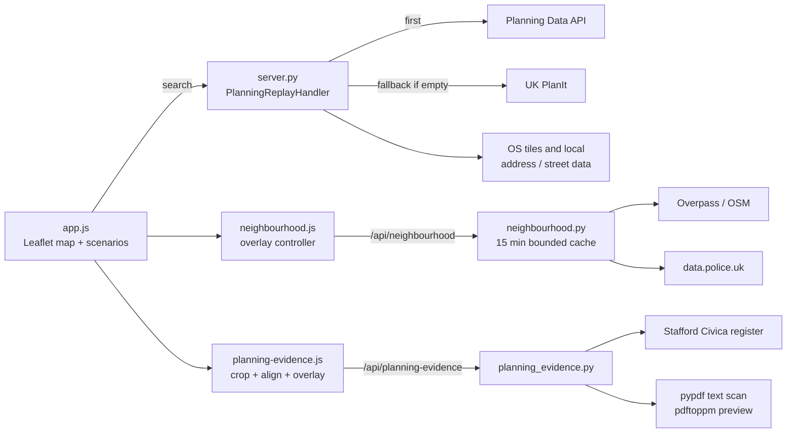
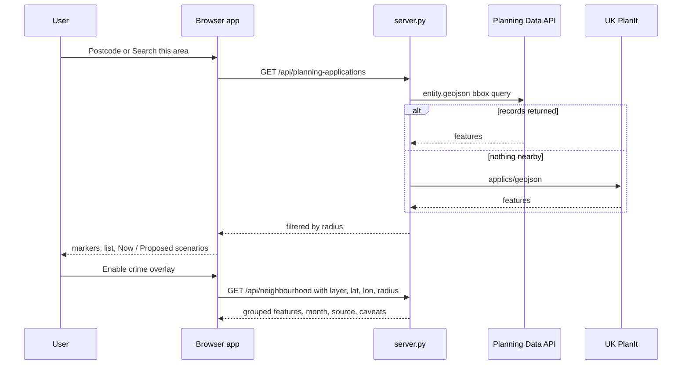

[View Repo :octicons-mark-github-16:](https://github.com/Ready2k/planning-replay){ .md-button }

# Planning Replay — UK Planning Application Explorer

**TL;DR:** A map-based explorer for UK planning applications. Search by postcode or by map area, see what has been applied for nearby with a Now / Proposed / Completed view, layer in crime and facilities context, and place council plan PDFs on the map by hand-matching landmarks. It never invents buildings the source data doesn't support.

**Stack:** Python standard-library HTTP server • Vanilla JS + Leaflet • Planning Data API • UK PlanIt (fallback) • Overpass / data.police.uk • pypdf + pyproj • Node and Python tests

---

## ✨ Features

- **📮 Postcode or map search** - Or explore the UK map and search around its centre, with 250 m, 500 m and 1 km radii
- **🔄 Data fallback** - The government Planning Data API is queried first; UK PlanIt is used when it returns nothing nearby
- **🏘️ Neighbourhood scenarios** - Now, Proposed and Completed views; Completed is only offered once a source site layout has been matched and located
- **🗂️ Local filtering** - Search loaded records by address, status or description; filters survive opening an application
- **🗺️ Six on-demand overlays** - Reported crime, schools, healthcare, parks, public transport, shops and community facilities, each fetched for the searched area
- **📄 Council plan discovery** - "Find plans" retrieves a Stafford application's document inventory and ranks site layouts and location plans first
- **📐 Reviewed placement** - Crop one drawing, match three landmarks, review the overlay, then save locally
- **🧱 Optional OS context** - Address points and street lines from OS open data, off by default
- **🛡️ Bounded server** - 15-minute caches, 40 MB document cap, timeouts on every upstream call

---

## 🧠 Architecture

---

## 🎯 What Makes This Special

### Honesty about data
Application points are approximate, not site boundaries, and an empty result is not proof that nothing exists. The app builds no future buildings or construction phases from them. Completed stays unavailable until a plan is matched and geolocated, and receipt dates are not treated as evidence that something was built. The Proposed view excludes refused, withdrawn and completed statuses but still doesn't claim construction is pending.

### Reviewed placement instead of automatic reconstruction
Council registers differ, so the project ships one working connector (Stafford's Civica register) and a human-in-the-loop alignment step. The user matches three landmarks on drawing and map, and the app applies a three-point affine transform. It rejects collinear or mirrored matches and states that three points fit exactly and prove nothing about accuracy. The docs record that two real applications behaved differently and one council has no connector yet.

### Safe retrieval by construction
The evidence API never fetches a caller-supplied URL. Document IDs must belong to the application's current inventory, downloads are capped at 40 MB, and preview subprocesses time out. Exact-reference matching rejects near-miss applications.

### Stale-work control in the UI
The overlay controller keeps a generation counter and per-layer `AbortController`s, so a new search cancels in-flight requests and discards late responses. Failed layers show a retry button, and "no records" is a different state from "source unavailable".

---

## 🚀 Technical Highlights

### Server
- `server.py` is a `SimpleHTTPRequestHandler` subclass exposing 11 API routes (720 lines)
- `neighbourhood.py` validates layer, UK bounds and a 100 to 1000 m radius, then caches by key for 900 s with a 128 entry cap
- Crime uses the latest reporting month from data.police.uk, filters to the search circle by haversine distance and groups incidents sharing a point

### Evidence pipeline
- `planning_evidence.py` classifies documents as location, layout, report or other from their titles
- It scans PDF text for likely plan pages and explicit site-centre grid references, converting with `pyproj`
- Inventories are cached 15 minutes and PDFs 24 hours, keyed by content hash

### Frontend
- Vendored Leaflet, no build step; scenario logic is split into small modules testable from Node
- Saved placements are keyed to browser, application, PDF hash and page, and switching context removes the overlay

---

## 📊 Key Metrics

- **Code**: `server.py` 720 lines, `app.js` 1,458, `planning-evidence.js` 356, `planning_evidence.py` 187 (excluding vendored Leaflet)
- **API routes**: 11
- **Tests**: 8 Node tests (all pass) and 13 Python test functions
- **Live acceptance**: Stafford 23/37093/OUT matched 79 PDFs; 25/40406/ESS matched six
- **Dependencies**: 2 Python packages (`pyproj`, `pypdf`)
- **Docs**: 639-line product spec plus a data and imagery strategy

---

## 🛠️ Development Process

The 639-line `PLANNING_REPLAY_SPEC.md` and the OpenAPI and provider-adapter contracts in `contracts/` came first. The app then narrowed over iterations. Historical timeline and playback controls were removed because they implied knowledge the data lacked, and `docs/plan-evidence.md` records what each real application showed. The remaining work, such as more council connectors and automatic georeferencing, is listed openly.

---

*This project demonstrates civic-data integration, graceful multi-source fallback and an uncertainty-first approach to presenting data.*
