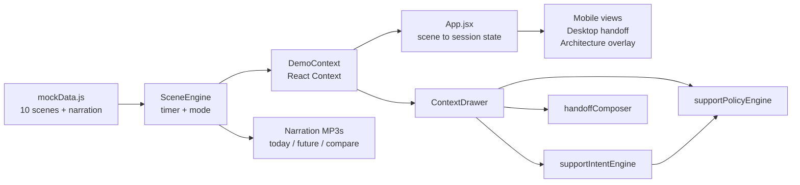
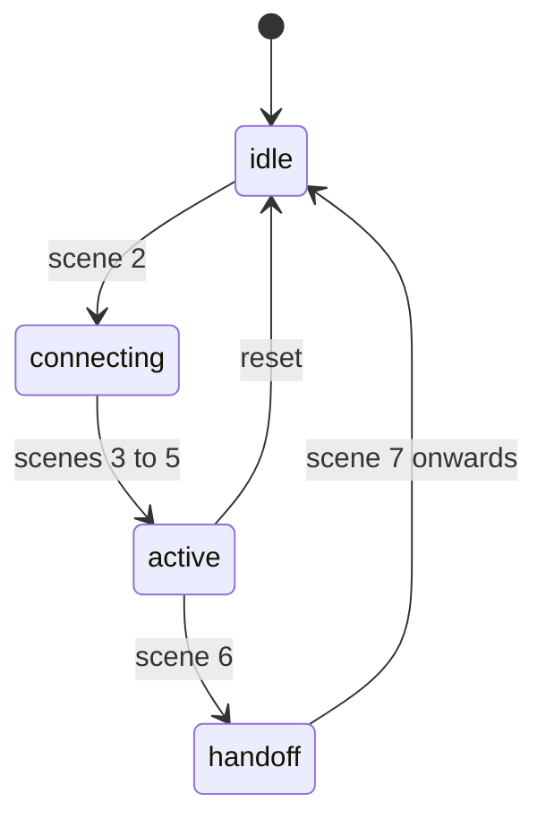

[View Repo :octicons-mark-github-16:](https://github.com/Ready2k/inAppExperience){ .md-button }

# In-App Experience — Vision 2028 Banking Support

**TL;DR:** A fully client-side pitch demo that contrasts legacy PSTN banking support (dial, navigate a phone menu, wait, re-verify) with an AI-native, WebRTC-style in-app call. A 10-scene narrative plays in *Today*, *Future* or side-by-side *Compare* mode, with pre-generated British-English narration. It is a companion to the [Ambient Banking Assistant](pr10_FinTechDemo.md).

**Stack:** React 19 • Vite 8 • Framer Motion • React Context • custom Scene and Session engines • Amazon Polly MP3 narration • No backend, no API keys

---

## ✨ Features

- **🎬 10-scene narrative** - Inbound support journey (scenes 0 to 7) followed by a secure outbound-call story (scenes 8 and 9), auto-advancing at 15 seconds per scene
- **↔️ Three demo modes** - Today, Future, and a synchronised Compare view that narrates each scene's delta
- **📞 Session lifecycle** - `idle → connecting → active → handoff`, derived from the current scene
- **🧠 AI Context Drawer** - Intent, confidence, signals and permitted actions for the moment on screen
- **🛡️ Support policy engine** - Eight named actions, each tagged `none`, `low` or `medium` risk, gated by intent and session state
- **🤝 Human handoff package** - A composed "context luggage" payload shown on a colleague desktop next to the customer phone
- **🏗️ Architecture overlay** - A strategic WebRTC vs PSTN diagram as scene 7
- **🔊 Narration** - 30 pre-generated MP3s (3 modes x 10 scenes) with a Web Speech API fallback
- **🎛️ Presenter controls** - Playback, speed, scene jump, narrator toggle, mode switch, reset
- **🌗 Light and dark themes**

---

## 🧠 Architecture

---

## 🎯 What Makes This Special

### Stable engines, no stale closures
`SceneEngine` is a plain class created once via `useRef`. It holds the timer, current index, mode and speed outside React. Narration and scene-change callbacks reach React state through mutable refs (`narratorEnabledRef`, `setCurrentSceneRef`) that effects keep current. Auto-play therefore never reads stale state, and the engine is never re-created when the presenter flips a toggle mid-demo.

### Guardrails modelled, not just narrated
The AI is shown acting inside a policy layer. `supportIntentEngine` maps a scene (and a flagged transaction) to an intent with a confidence score, for example 0.92 for a card dispute and 0.97 for escalation. `supportPolicyEngine` then returns only the actions allowed for that intent, and only `View Transaction Detail` while the session is `idle` or `connecting`. Both are commented as stand-ins for a real classifier and rules service.

### The handoff is the point
Most chatbot demos end when the bot is done. Here, scene 6 renders the customer phone and a colleague desktop side by side, with a payload from `handoffComposer`: issue, transaction, actions taken, urgency, sentiment, recommended next step and a transcript excerpt. The specialist starts with context, which is the strongest contrast to a PSTN transfer where the customer repeats everything.

### Compare mode narrates the delta
Compare narration is not today's script plus future's script. Each scene carries a `delta` line (for example "Anonymous PSTN number vs verified in-app identity") and a `compareNarrative`, and the compare MP3s speak that difference. This keeps side-by-side viewing short enough to follow.

---

## 🚀 Technical Highlights

### State and playback
- `DemoContext` exposes scene, mode, play state, speed, theme, narrator and drawer state through a `useDemo()` hook
- Scene delay is `(scene.duration || 15000) / speed`; no scene sets its own duration, so all use 15 seconds scaled by the speed multiplier
- `App.jsx` derives session state from the scene id in an effect, so the lifecycle always matches the scene the presenter jumps to

### Narration pipeline
- `scripts/generate-narration-ssml.sh` (348 lines) calls Amazon Polly (neural voice Amy, en-GB, 24 kHz) and writes `public/narration/{mode}/scene{N}.mp3`
- Playback tries the MP3 first, and falls back to `SpeechSynthesisUtterance` only if that audio is still the active one, so TTS never overlaps a newer MP3

### UI and delivery
- `MobileFrame` (390x844) and `DesktopFrame` (1200x800) wrap views; Framer Motion handles scene transitions
- Theme is applied by setting `data-theme` on the root element
- A GitHub Actions workflow builds and deploys to GitHub Pages on push to `main`; narration paths use `import.meta.env.BASE_URL` so they work under a sub-path

---

## 📊 Key Metrics

- **Scenes**: 10 scenes, each with Today and Future narration plus a compare narrative
- **Narration assets**: 30 MP3 files (10 per mode)
- **Source**: 3,963 lines across `src/`, `scripts/` and `spec/`; 24 JS, JSX and CSS files under `src/`
- **Runtime dependencies**: 4 (react, react-dom, framer-motion, lucide-react)
- **Policy model**: 6 intents, 8 actions
- **Tests**: none; the project is a presentation demo, checked with ESLint 9

---

## 🛠️ Development Process

Built spec-first: `spec/in_app_experience_spec.md` defines the narrative and screens, and a `CLAUDE.md` captures architecture rules for AI-assisted iteration. The inbound story was built first, then extended with the two outbound scenes (the narration script header already covers scenes 0 to 9). Narration text lives in `mockData.js` and is regenerated with a single script, so script edits and audio stay in sync.

---

*This project demonstrates storytelling-driven product prototyping: a narrative state machine, a modelled policy layer and a human handoff, delivered with zero infrastructure.*
