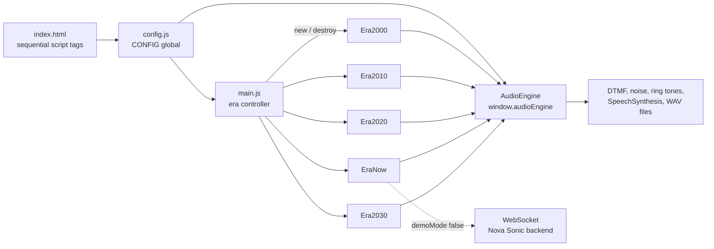
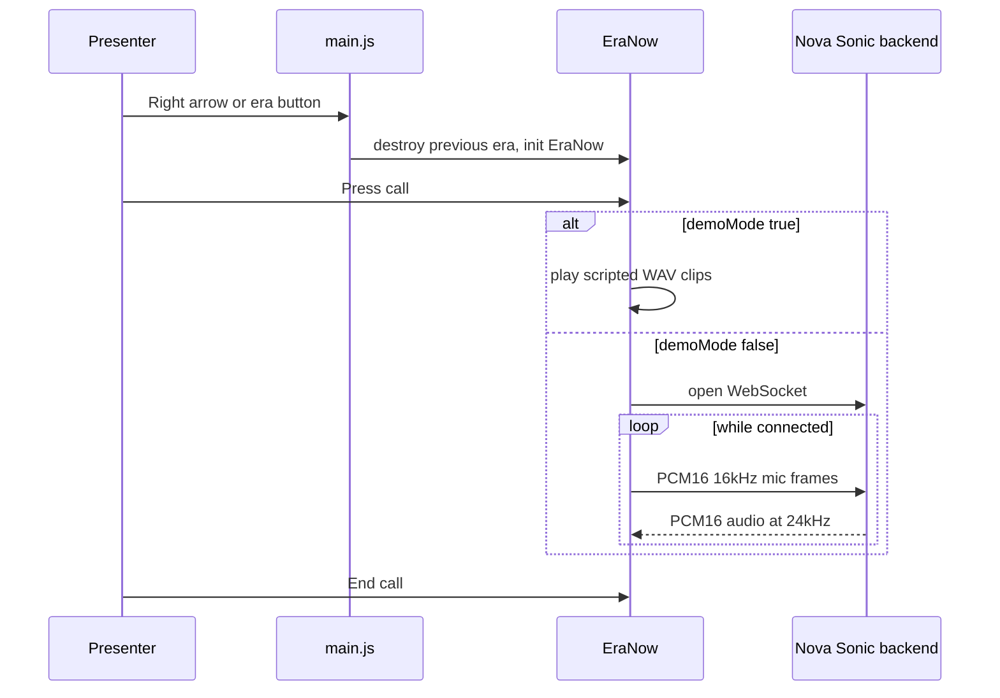

[View Repo :octicons-mark-github-16:](https://github.com/Ready2k/ivr-evolution-demo){ .md-button }

# IVR Evolution — From DTMF to AI Voice Agents

**TL;DR:** An interactive presentation demo that replays one scenario, a customer reporting a lost debit card, across five generations of phone banking. It runs from 2000s keypad menus to 2025 AI voice agents, then a speculative 2027+ era where the bank calls you. Each era is built to show what that technology could not do. There is no build step, framework or dependencies.

**Stack:** Vanilla JavaScript • Web Speech API • Web Audio API • WebSocket (optional live Nova Sonic backend) • Pre-recorded WAV clips

---

## ✨ Features

- **📞 Working DTMF keypad (2000s)** - Real dual-tone sounds synthesised with Web Audio oscillators, navigating a menu tree that always ends in a hold queue
- **🎙️ Deliberately flawed ASR (2010s)** - Scripted playback with a 25% misrecognition chance and phrases like "cost card" and "ghost card", so the failure is visible
- **🔊 Conversational bot (2020s)** - Intent and slot-filling flow driven by 7 pre-recorded clips
- **🤖 AI voice agent (2025)** - Scripted playback from 9 clips, or a live WebSocket call to a Nova Sonic backend (see [Voice S2S Platform](pr7_VoiceS2S.md))
- **🎭 Off-script prompts** - Five suggested interruptions in the 2025 era, such as "Can you just freeze everything on my account immediately?"
- **📲 Proactive AI call (2027+)** - Scripted branching flow where the AI phones the customer, backed by 7 clips
- **🎬 Theater mode** - Full-screen hardware render splash on each era switch, with pause and resume controls
- **⌨️ Presenter keys** - Left and right arrows move between eras, `R` resets the current era
- **⚙️ Runtime settings** - Override the WebSocket URL, AWS credentials and bank name without editing files
- **📊 Per-era trade-off bars** - Each era carries a trade-off position, tech badges and noise levels in config

---

## 🧠 Architecture

The 2025 era has two paths. In demo mode it never touches the network. In live mode it streams microphone audio to the backend and plays the reply.

---

## 🎯 What Makes This Special

### Failure as the Product
Each era is designed to show where its technology breaks. The 2000s menu tree routes the lost-card option to "cannot be completed via automated service" and then a 22-minute hold. The 2010s era injects misrecognition on 25% of turns from a fixed phrase list. Because the same scenario runs in every era, an audience compares the experiences directly instead of reading about them.

### Demo Mode Removes Live Risk
Three eras ship with `demoMode: true`: 2010s, 2020s and 2025. Scripted playback means a presentation does not depend on microphone permission, room noise, or a network. Live recognition and the live Nova Sonic call remain one config flag away. The 2025 era can still go off-script with five prepared prompts when the presenter wants to show real behaviour.

### Config as Single Source of Truth
`config.js` holds the bank name, backend settings, system prompt and per-era content: titles, badges, trade-off positions, menu trees, scripts and intent definitions. White-labelling for another bank means changing the bank name and the system prompt. The era classes contain behaviour only.

### Self-Contained Era Lifecycle
Every era class implements `init(container, convPanel)` and `destroy()`. The controller creates one instance and tears it down on a switch, so each era starts clean when a presenter jumps back and forth mid-talk.

---

## 🚀 Technical Highlights

### Audio Layer
- `AudioEngine` is a single `window.audioEngine` instance shared by all eras
- DTMF tones are generated from paired oscillators with short attack and release ramps to avoid clicks
- Line noise and crackle come from a generated noise buffer, with levels set per era in config
- Prompts use a pre-recorded file when one is configured and fall back to browser `SpeechSynthesis` otherwise

### Live Mode
- Microphone audio is sent as PCM16 mono, 16kHz, in 4096-sample chunks over binary WebSocket frames
- Replies are played as PCM16 at 24kHz
- If no AWS credentials are entered for a localhost backend, the UI shows a soft warning but still attempts the call, since the backend may hold credentials

### No-Build Delivery
- Scripts load in a fixed order from `index.html`: config, audio engine, five eras, then the controller
- Shared `?v=` query strings on every CSS and JS include handle cache-busting
- Served with `./start.sh` (Python http server on 8081) or `npm start` (`npx serve` on 8080); it must be served over HTTP, not `file://`
- Speech recognition needs Chrome or Edge

---

## 📊 Key Metrics

- **Eras**: 5, all following one lost-card scenario
- **JavaScript**: 3,317 lines across 7 files in `js/`, plus a 524-line `config.js`
- **CSS**: 3,359 lines across 3 stylesheets
- **Audio clips**: 23 WAV files (7 for 2020s, 9 for 2025, 7 for 2027+)
- **Hardware renders**: 5 phone images, one per era
- **Dependencies**: 0 runtime packages
- **Docs**: A 138-line journey map documenting each era's flow

---

## 🔨 Development Process

Built with Claude Code as a small, single-purpose presentation tool. Clips are generated with three shell scripts using macOS `say`, so they can be regenerated when wording changes. The project's `CLAUDE.md` records the script load order, the era pattern and the cache-busting rule, so later edits stay consistent. The repo has 10 commits.

---

*This project demonstrates how a deliberately simple, dependency-free build can make technology evolution tangible, by letting an audience feel each era's limits rather than read about them.*
