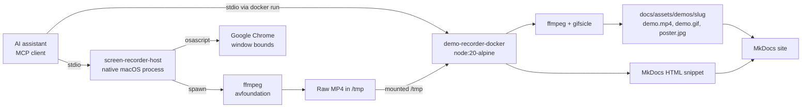
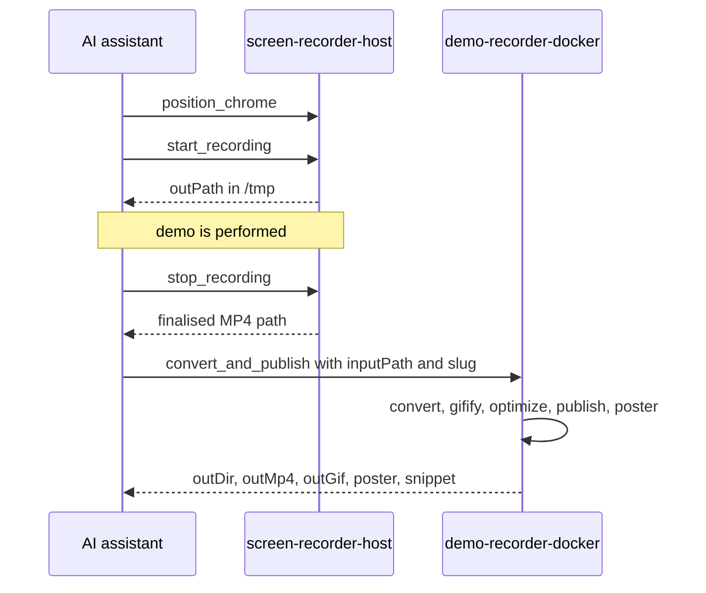

[View Repo :octicons-mark-github-16:](https://github.com/Ready2k/demomcp){ .md-button }

# demomcp — MCP Servers for Demo Recording

**TL;DR:** A monorepo of two Model Context Protocol servers that let an AI assistant record and publish demos. One captures a region of the macOS screen on the host, and the other runs inside Docker to turn the recording into an MP4, an optimised GIF, a poster frame and a ready-to-paste MkDocs snippet.

**Stack:** TypeScript • `@modelcontextprotocol/sdk` (stdio) • Zod • ffmpeg + AVFoundation • gifsicle • AppleScript • Docker (`node:20-alpine`)

---

## ✨ Features

- **🎥 `screen-recorder-host`** - Host-side MCP server with 5 tools: `list_devices`, `position_chrome`, `start_recording`, `stop_recording` and `status`
- **🪟 Window staging** - `position_chrome` drives Google Chrome through AppleScript so every recording starts from the same frame (defaults to 1280x720 at 0,80)
- **✂️ Region capture** - ffmpeg and AVFoundation record a cropped region at a configurable frame rate (default 30 fps), with an optional duration cap
- **🐳 `demo-recorder-docker`** - Containerised MCP server with 6 tools: `convert_video`, `gifify`, `optimize_gif`, `publish_assets`, `mkdocs_snippet` and `convert_and_publish`
- **🎞️ Two-pass GIFs** - ffmpeg `palettegen` then `paletteuse` with a selectable dither (`none`, `sierra2_4a`, `bayer`), followed by `gifsicle -O3`
- **📦 Asset publishing** - Copies outputs into `docs/assets/demos/<slug>/` and extracts a poster JPG at the 1-second mark
- **📝 MkDocs snippets** - Emits a `<video>` embed with poster and GIF fallback, or a GIF-only `<figure>` when `preferGif` is set
- **🧰 Typed tools** - Every tool has a Zod input schema with defaults and returns both text and `structuredContent`
- **⚡ One-shot mode** - `MCP_ONESHOT=1` with `ARGS_JSON` runs the whole pipeline as a plain CLI, bypassing MCP for quick testing

---

## 🧠 Architecture

The two servers never talk to each other. The assistant hands the recording path from one to the other, and the shared `/tmp` mount is what makes that path valid on both sides.

---

## 🎯 What Makes This Special

### Split by Trust Boundary
Screen capture needs AVFoundation, AppleScript and macOS permissions, so it cannot live in a container and runs natively. Video processing needs a specific ffmpeg and gifsicle toolchain, so it is the opposite: pinned inside an Alpine image where it behaves identically on any machine. The split puts each server where its dependencies already are, and the `bin/` wrappers hide the difference from the client.

### Closes the Loop to Publication
Most recording tools stop at a video file. `convert_and_publish` carries on: it places assets at the path MkDocs expects, makes a poster, and returns the HTML to paste. Recording a demo and getting it onto a page becomes one conversation instead of a manual ffmpeg session.

### Granular Tools Plus an Orchestrator
The pipeline is exposed twice. The individual tools (`convert_video`, `gifify`, `optimize_gif`, `publish_assets`) let an assistant redo one step, for example re-running the GIF at a different dither without re-encoding. `convert_and_publish` runs the full chain in one call when the defaults are fine. Both share the same Zod defaults, so behaviour stays consistent.

### A Non-MCP Escape Hatch
`MCP_ONESHOT=1` makes the same server run the pipeline from an `ARGS_JSON` environment variable and exit with JSON on stdout. That allows the container to be tested from a shell, or in a script, without an MCP client attached.

---

## 🚀 Technical Highlights

### Host Recorder
- A single module-level `active` record holds the ffmpeg child process, so only one recording can run at a time. A second `start_recording` returns the existing path instead of starting another
- `stop_recording` sends `SIGINT` and waits for the process `close` event, which lets ffmpeg write the MP4 trailer so the file is playable
- `position_chrome` writes a temporary AppleScript to `/tmp` and passes the geometry as `argv`, rather than interpolating values into script text

### Processing Container
- All subprocess calls go through one `run()` wrapper around `execFile` with a 10 MB buffer; failures reject with ffmpeg's stderr, so the assistant sees the real error
- Encoding uses H.264 `libx264`, `veryfast` preset, `yuv420p` for broad playback compatibility, lanczos scaling with an even height (`scale=W:-2`) and audio stripped
- `crf` is bounded to 18-35 and GIF colours to 32-256 by the schemas, so out-of-range values are rejected before ffmpeg runs

### Packaging
- npm workspaces monorepo; both packages use the same dependency ranges (`@modelcontextprotocol/sdk ^1.20.0`, `zod ^3.23.8`, TypeScript `^5.6.3`)
- The root `run:docker:oneshot` script mounts `$PWD` as `/repo` and `/tmp` as `/tmp` so inputs and published assets land on the host

---

## 📊 Key Metrics

- **MCP tools**: 11 in total (5 host, 6 container)
- **Source size**: 538 lines of TypeScript across the two entry files (135 host, 403 container)
- **Packages**: 2 in an npm workspace, both on `@modelcontextprotocol/sdk ^1.20.0`
- **Runtime dependencies**: 2 per package (MCP SDK and Zod)
- **Container**: `node:20-alpine` with ffmpeg and gifsicle from `apk`
- **Steering docs**: 3 (`product.md`, `structure.md`, `tech.md` under `.kiro/steering/`)
- **Automated tests**: none; the one-shot mode is the manual smoke test

---

## 🛠️ Development Process

Developed with Claude Code (the repo carries a `CLAUDE.md`) and Kiro steering documents describing the product, structure and tech choices. The repository has 6 commits.

---

*This project demonstrates building practical MCP tooling that automates a real workflow, from window positioning to a published, embeddable demo.*
